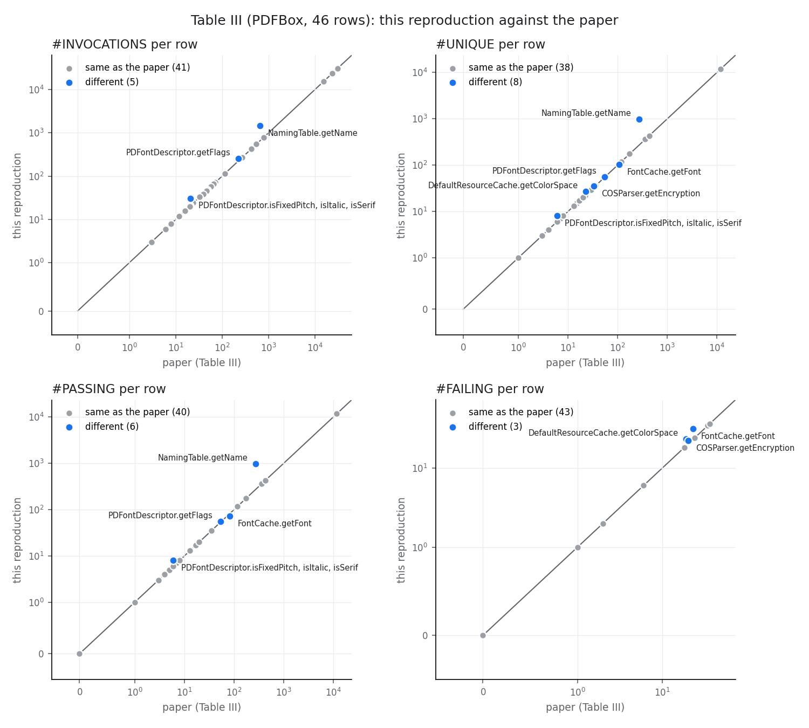

# Reproduction de l'étude de cas 2 (PDFBox) de « Production Monitoring to Improve Test Suites »

*Rapport de reproduction, version 1 — Ahmed Dhibi, 25 octobre 2026.*
*Dépôt : https://github.com/Ahmeddhibi19/Pr-Benoit-test*

## Résumé

L'étude de cas 2 de l'article (section IV.C) applique PANKTI à Apache PDFBox 2.0.21 : observer une charge de travail de « production », en tirer des tests unitaires différentiels pour les méthodes pseudo-testées, puis mesurer combien de ces méthodes deviennent bien testées. Je l'ai reproduite de deux façons : en confrontant l'article aux artefacts publiés par les auteurs, et en ré-exécutant toute la chaîne avec leurs outils sur GitHub Actions.

- **Reproduit exactement :** les 138 cibles ; les 46 cibles effectives (avec l'état du cache de polices des auteurs) ; les 13 851 tests publiés, régénérés à l'identique ; leurs #PASSING et #FAILING (13 614 / 237) pour les 46 lignes ; le statut final, **28 cibles sur 46 bien testées**, avec nos tests comme avec ceux des auteurs ; l'exemple `isFill` ; la section V.B.
- **Reproduit en forme :** les colonnes de la charge de travail du tableau III (38 lignes sur 46 identiques ; les autres sont des méthodes liées aux polices, dont les valeurs dépendent des polices installées et du cache de polices).
- **Non reproduit :** la profondeur d'imbrication de 36, que l'article ne définit pas (73 dans les données des auteurs comme dans les nôtres).
- **Constats principaux :** (1) un test généré réussit exactement quand la valeur observée en production était `null`, parce que l'oracle compare par `equals` des objets qui comparent par identité ; (2) pour 9 lignes du tableau III, le mécanisme d'échec diffère de celui de l'article (caches indexés par identité, non pas absents) ; (3) le statut final de chaque cible se prédit à partir des valeurs observées (82 mutants sur 82) : les 28 cibles améliorées renvoient des valeurs simples, les 18 autres des objets.

La comparaison complète, nombre par nombre et avec le fichier source de chaque valeur, est dans `results/comparison/comparison.txt`.

Conventions :
- **[Publié]** : valeur ou affirmation de l'article ;
- **[Artefacts]** : données publiées par les auteurs (dépôt `pankti-experiments`, archive Zenodo) ;
- **[Mesuré]** : résultat obtenu dans cette reproduction ;
- **[Interprétation]** : analyse personnelle, distincte des faits.

Les chemins `docs/...`, `results/...` et `analysis/...` renvoient à ce dépôt. Chaque nombre cité est produit par un script du dépôt ou par une exécution GitHub Actions identifiée.

---

## 1. Introduction et objectifs

Le travail demandé consiste à reproduire les résultats de l'étude de cas 2 (section IV.C) de l'article suivant :

> D. Tiwari, L. Zhang, M. Monperrus, B. Baudry, *Production Monitoring to Improve Test Suites*, IEEE Transactions on Reliability, 2021 (arXiv 2012.01198v4).

Il faut ensuite documenter le code dans un dépôt GitHub et résumer l'expérience, les observations et les réflexions dans un rapport.

**Question de recherche de l'article.** Peut-on améliorer une suite de tests en observant l'application en production ? L'outil proposé, PANKTI :
1. instrumente des méthodes « cibles » ;
2. enregistre, pour chaque appel, l'objet receveur, les arguments et la valeur renvoyée (un *profil d'objet*) ;
3. transforme chaque profil distinct en *test unitaire différentiel* : désérialiser, appeler la méthode, comparer le résultat à la valeur observée.

Les cibles sont des méthodes *pseudo-testées* : elles sont exécutées par les tests existants, mais aucun test n'échoue si leur corps est remplacé par une valeur par défaut. Ce critère est mesuré par l'outil Descartes.

**Étude de cas 2.** PANKTI est appliqué à Apache PDFBox 2.0.21 avec une charge de travail : 10 commandes en ligne × 5 fichiers PDF du corpus GovDocs1.

Résultats à reproduire **[Publié]** :

| Grandeur | Valeur publiée |
|---|---|
| #TARGET (méthodes pseudo-testées ciblées) | 138 |
| #EFF_TARGET (cibles invoquées par la charge) | 46 |
| Invocations / profils collectés / profils uniques | 121 175 / 57 563 / 13 851 |
| Taille des profils | 5,5 Go ; de 158 octets à environ 55 Mo ; profondeur d'imbrication maximale 36 |
| Méthodes ayant atteint le seuil de 200 Mo | 19 |
| Tests générés / qui passent / qui échouent | 13 851 / 13 614 (98,3 %) / 237 |
| Cibles devenues « bien testées » | 28 sur 46 (60,9 %) |
| Exemple | `RenderingMode.isFill` : 30 944 appels, un seul profil distinct, un test intégré ensuite à PDFBox |

**Démarche.** La reproduction suit deux pistes :
- **(A)** confronter l'article aux artefacts publiés par les auteurs ;
- **(B)** ré-exécuter toute la chaîne dans un environnement contrôlé et documenté (GitHub Actions, Linux).

**Critères de réussite, fixés avant les expériences.** Certains nombres sont fixés par le code et les données : un accord **exact** est attendu (les 46 cibles pseudo-testées avant, `isFill`, les tests générés à partir des profils des auteurs). D'autres dépendent de l'exécution de la charge de travail sur une machine donnée : un accord **de forme** est attendu (même ordre de grandeur des rapports collectés / invocations, uniques / collectés, taux de réussite et taux de cibles bien testées ; mêmes conclusions qualitatives). Pour les cibles effectives, l'accord est mesuré **par ensemble** (indice de Jaccard, chaque différence expliquée). Enfin, une **vérification de prédiction** : prévoir le statut final de chaque cible à partir des valeurs observées, puis comparer avec Descartes. Le bilan de ces critères est en section 8.11.

## 2. Méthodologie originale

La chaîne de l'étude de cas comporte cinq étapes ; les métriques sont définies à la section III.E de l'article.

1. **Cibles.** Descartes analyse la suite de tests de PDFBox par *mutation extrême* : le corps de chaque méthode est remplacé par `return null`, `true`/`false`, `0`/`1`, etc. Une méthode couverte dont aucun mutant n'est détecté est *pseudo-testée*. PANKTI ne retient que les méthodes publiques, non statiques, non abstraites, non vides, non dépréciées et qui renvoient une valeur. Cela donne #TARGET.
2. **Observation.** Les cibles sont instrumentées par un plugin Glowroot. PDFBox exécute la charge de travail ; chaque appel d'une cible est sérialisé en XML (XStream). Un seuil de 200 Mo par méthode limite la collecte. On en tire #EFF_TARGET, #INVOCATIONS, #COLLECTED et SIZE.
3. **Génération.** Un test est produit par profil distinct (#UNIQUE = #PANKTI_TESTS).
4. **Exécution.** Chaque test est exécuté (5 fois, contre le non-déterminisme), ce qui donne #PASSING et #FAILING.
5. **Évaluation.** Descartes est relancé avec les nouveaux tests. Une cible qui n'est plus pseudo-testée est « bien testée » (métrique 14 : « not pseudo-tested anymore »), c'est-à-dire *tested* ou *partially-tested* pour Descartes.

**[Artefacts]** Avec cette lecture, les derniers rapports Descartes des auteurs redonnent exactement les 46 statuts du tableau III (`results/day1/authors_report_vs_paper.csv`).

L'article ne précise pas : la version de PANKTI, celles de Descartes et de PIT, la configuration de Descartes, ni le script exact de la charge de travail. Tous ces éléments ont été retrouvés dans les artefacts des auteurs (section 6).

## 3. Méthodologie d'implémentation

**Principe.** Le dépôt ne réimplémente pas PANKTI : il pilote les outils originaux et mesure leurs sorties. Les étapes sont des flux GitHub Actions :

| Flux | Rôle |
|---|---|
| `env-check` | construction de PDFBox 2.0.21 et de sa suite de tests |
| `descartes-before` | Descartes, un module par tâche |
| `production-run` | plugin PANKTI, Glowroot, `pdfbox-app`, puis la charge de travail (modes `dry-run`, `smoke`, `full`) |
| `generate-tests` | génération des tests (pankti-generate) à partir de nos profils et de ceux des auteurs |
| `assess-tests` | intégration des tests dans PDFBox et exécution répétée (5 fois) |
| `descartes-after` | Descartes après ajout des tests générés qui réussissent (les nôtres, ceux des auteurs, aucun pour le contrôle) |

Des scripts Python dans `analysis/` calculent les métriques à partir des sorties brutes. Ils ont des tests unitaires (`tests/`).

**Procédure suivie :**
1. Construction de PDFBox et ajustements de construction (`scripts/pdfbox/patch-build.sh`).
2. Descartes « avant » sur les 6 modules, avec un seul fil d'exécution (`docs/descartes.md`).
3. Extraction des cibles avec les outils des auteurs (`scripts/pankti/extract-targets.sh`), puis liste figée `results/targets.csv`.
4. Plugin construit avec le générateur des auteurs (`instrument.py`), installé dans Glowroot. Vérification sans charge de travail.
5. Charge de travail : le script `run.sh` des auteurs, inchangé sauf les deux chemins propres à leur machine.
6. Métriques des profils (`analysis/profile_stats.py --fragments`) et comparaison au tableau III (`analysis/compare_table3.py`).
7. Génération des tests avec pankti-generate (`scripts/pankti/generate-tests.sh`), à partir de nos profils et, pour validation, de ceux des auteurs (`docs/generation.md`).
8. Intégration des tests dans PDFBox (`scripts/pankti/integrate-tests.sh`).
9. Exécution des tests générés 5 fois, chaque fois dans une nouvelle JVM (`scripts/pankti/run-generated-tests.sh`), et décompte par méthode (`analysis/test_outcomes.py`).
10. Descartes « après » sur fontbox et pdfbox, avec les seuls tests qui réussissent aux 5 exécutions (`scripts/pankti/keep_passing_tests.py`), puis statut final des cibles (`analysis/pankti_status.py`, `analysis/table3_status.py`). Une exécution de contrôle sans test généré sert de témoin.
11. Analyse des échecs, des cibles non améliorées et vérification de la prédiction, sur les deux jeux de tests (`analysis/failure_analysis.py`, `analysis/prediction_check.py`), puis comparaison à trois voies article / artefacts / reproduction (`analysis/comparison.py`, `results/comparison/`).

**Validation des outils de mesure.** Avant d'être appliqués à nos données, les scripts de mesure ont été validés sur les données brutes des auteurs (5,9 Go de profils XML). **[Mesuré sur les artefacts]** Ils redonnent exactement :
- les colonnes #INVOCATIONS, #COLLECTED et #UNIQUE du tableau III pour les 46 méthodes (121 175 / 57 563 / 13 851) ;
- les 19 méthodes plafonnées ;
- la taille minimale (158 octets) et la taille totale (5,49 Gio).

(`results/day4/authors_profile_metrics.txt`)

## 4. Environnement expérimental

Mesures (détails dans `docs/environment.md`) :
- exécuteur GitHub `ubuntu-22.04`, 4 vCPU AMD EPYC 7763, 15 Gio ;
- AdoptOpenJDK 11.0.8+10, celui du journal d'exécution des auteurs ;
- Maven 3.6.3, polices Liberation ;
- PDFBox 2.0.21 (`fa8029d8`), PIT 1.4.10 + Descartes 1.2.6 (21 opérateurs), PANKTI `0fddf27` (dernier commit avant l'exécution des auteurs du 3 novembre 2020), Glowroot 0.13.6 ;
- générateur pankti-generate `7afc584` (version des tests publiés, section 6, point 7) ;
- données Zenodo, version 1.

Configuration des étapes :
- Descartes : un seul fil d'exécution, opérateurs et délais par défaut, classes cibles par module ;
- charge de travail : `run.sh` des auteurs, cache de polices vide, 50 lancements de JVM ;
- génération : tas de 12 Go ;
- exécution des tests : réglages surefire de PDFBox (`-Xmx768m` pour le module pdfbox), 5 exécutions séparées ;
- Descartes « après » : même configuration que « avant », mutation limitée aux 22 classes qui déclarent les cibles effectives, avec tous les tests du module.

Le portable Windows sert seulement au développement : le système d'exploitation influence les résultats (section 9).

## 5. Décisions d'implémentation

Les choix qui orientent toute la reproduction, et leur lien avec l'article :

| Décision | Lien avec l'article | Pourquoi |
|---|---|---|
| Piloter les outils originaux (pankti-extract, l'instrumentation, pankti-generate, `find-pseudo-tested.py`, `run.sh`) au lieu de les réimplémenter | l'article évalue l'outil PANKTI | reproduire les résultats de l'outil, pas ceux d'une réimplémentation |
| Deux pistes : artefacts des auteurs (A) et ré-exécution (B) | — | séparer les effets de l'outil de ceux de l'environnement : les tests des auteurs sont exécutés dans notre environnement à chaque étape |
| Valider chaque script de mesure sur les données des auteurs avant de l'utiliser | les métriques de la section III.E | un écart vient alors de l'expérience, pas de la mesure |
| Toutes les mesures sur un exécuteur Linux, avec le JDK du journal des auteurs (A5) | machine des auteurs non décrite | le système change les résultats (polices, répertoires) |
| Descartes à un seul fil (A3) | configuration non décrite | le parallélisme fausse le résultat pour pdfbox |
| Liste de cibles figée à partir des rapports des auteurs (A8) | #TARGET = 138 | notre propre exécution donne aussi 138 cibles |
| Générateur `7afc584` (A17) | version non décrite | c'est celle qui produit exactement les tests publiés |
| 5 exécutions dans des JVM séparées ; « réussi » = réussit aux 5 (A19) | « 5 fois » | protocole non décrit ; critère le plus strict |
| Descartes « après » limité aux classes des cibles, avec une exécution témoin (A21) | non décrit | durée ; la restriction est validée par le témoin |
| Analyse de tous les tests en échec à partir des preuves, et non d'un échantillon (A23) | analyse manuelle d'un échantillon | reproductible et exhaustive |

## 6. Difficultés rencontrées

1. **Construction de PDFBox 2.0.21 six ans après.** La construction ne fonctionne plus telle quelle :
   - trois téléchargements de ressources de test sont morts (polices IPA, suite Isartor, un PDF de politique de certification) ;
   - un test dépend de l'ordre d'exécution ;
   - le certificat de test a expiré le 5 juin 2026.

   Il a fallu cinq exécutions d'intégration continue pour obtenir une construction propre. Les fichiers de remplacement, pris dans l'Internet Archive, ont la même empreinte sha512 que les originaux.
2. **Parallélisme de l'analyse de mutation.** Avec 4 fils PIT, choix naturel sur une machine à 4 cœurs, 25 des 40 cibles du module pdfbox devenaient « testées », dont `isFill`, ce qui contredisait l'article.
   - **Diagnostic** à partir des statuts de chaque mutant : 215 détections supplémentaires sont des dépassements de délai, 65 des échecs de tests qui écrivent dans des fichiers communs (`target/test-output`) ou téléchargent des PDF pendant le test.
   - **Confirmation** par une ré-exécution à un fil, qui redonne les résultats des auteurs.
   - **Conséquence si cela était passé inaperçu :** 91 cibles au lieu de 138, dont seulement 21 des 46 cibles effectives.
3. **Surcharges de méthodes.** Une première comparaison par nom de méthode fusionnait des surcharges (`toUnicode`, `getPath`). Corrigé en identifiant les méthodes par leur descripteur de paramètres, comme le fait PANKTI.
4. **Dérive des dépendances de PANKTI.**
   - pankti-extract (2020) se construit encore, mais le dépôt de snapshots qu'il déclare n'existe plus.
   - Ses intervalles de versions tirent aujourd'hui des bibliothèques Eclipse compilées pour Java 17 dans un outil exécuté en Java 11. Cela ne fonctionne que parce que ces classes ne sont jamais chargées.
5. **Fins de ligne et environnement Windows.**
   - Un jar construit depuis une copie Windows du code diffère de celui des auteurs sur 118 ressources texte.
   - Une empreinte calculée sur une copie Windows ne correspondait pas au fichier versionné (corrigé avant publication).
   - Un script fonctionnait avec un chemin absolu mais pas avec le chemin relatif utilisé en intégration continue ; une exécution a échoué, puis tout a été rejoué localement à l'identique avant de relancer.
6. **Définition de la « profondeur d'imbrication ».** L'article annonce une profondeur maximale de 36 sans la définir. Sur les données brutes des auteurs, la profondeur des éléments XML atteint 73 (`COSParser.getEncryption`). Aucune autre définition essayée ne donne 36 (sans les éléments `entry` : 72 ; éléments typés seulement : 51). L'autre chiffre de l'article, « `toUnicode` imbriqué sur 13 niveaux », correspond bien à la profondeur XML moins un (14 − 1). Question laissée ouverte (section 8).
7. **Version du générateur et retouches manuelles.** Les tests publiés par les auteurs n'ont pas été produits par la version de PANKTI utilisée pour la charge de travail (`0fddf27`). Ils contiennent des méthodes `deserializeObject()` que le générateur n'écrit qu'à partir du commit `7afc584` (12 novembre 2020), une méthode `setUpXStream()` dont l'appel est commenté dans le code du générateur, et des imports ajoutés à la main. L'hypothèse a été vérifiée en régénérant tous les tests à partir des profils des auteurs (section 8.6).
8. **Niveau de compilation des tests.** Les tests générés utilisent des convertisseurs qui dépendent de `java.lang.ref.Cleaner` (Java 9). Sous JDK 11, un profil de PDFBox impose `<release>6</release>` à toute compilation, ce qui annulait le réglage `testSource`/`testTarget` ; la compilation échouait. Seule la compilation des tests reçoit désormais `<release>9</release>`.
9. **Mémoire.** pankti-generate charge chaque fichier de profils (jusqu'à 210 Mo) en DOM ; la génération demande environ 12 Go et s'exécute sur l'exécuteur d'intégration continue, le portable n'ayant pas assez de mémoire libre.
10. **Découpage des classes de tests.** La première exécution a donné 301 échecs inattendus dans `HorizontalMetricsTable`. Cause : mon script de découpage des grandes classes supprimait la méthode `setUpXStream()`, que le générateur place entre les tests de deux méthodes cibles ; sans elle, le convertisseur nécessaire à la désérialisation d'un descripteur de fichier n'était pas enregistré. Corrigé, avec un test unitaire ; le résultat erroné est conservé comme trace (`results/day6/run-39641425498-split-bug/`).
11. **Tests publiés non compilables.** 18 des 22 classes publiées par les auteurs utilisent `@Before` sans l'importer ; l'import manquant a été ajouté à ces classes seulement (hypothèse A20).
12. **Sélection des tests par PIT.** Pour limiter Descartes « après » aux classes des cibles, j'ai restreint `targetClasses`. Un essai local a montré que toutes les méthodes devenaient « non couvertes » : pitest-maven restreint aussi, par défaut, les tests à ce même motif, et n'exécutait donc aucun test. Les tests sont désormais toujours désignés explicitement (`targetTests`).
13. **Un test instable sur une cible.** L'exécution de contrôle sans test généré a rendu `XrefTrailerResolver.getXrefType` « testée ». Le mutant `null` est tué par `TestOptionalContentGroups.testOCGConsumption` dans une exécution et pas dans l'autre. Ce test relit un fichier PDF laissé dans `target/test-output` et ne le régénère que s'il est absent ; le résultat dépend donc des fichiers écrits auparavant (section 8.8).

## 7. Hypothèses simplificatrices et adaptations méthodologiques

M. Baudry invitait à faire des hypothèses simplificatrices en cas de problème. Celles de ce travail ont trois origines : **(a)** l'article ne dit pas comment faire (configuration, protocole, définitions) ; **(b)** une contrainte pratique empêche de refaire exactement la même chose six ans plus tard ; **(c)** un choix de mesure, quand les artefacts montrent que la mesure publiée pourrait être prise autrement. Pour chacune, le tableau donne le problème, l'hypothèse, sa justification, son effet et sa validation, puis ce qu'elle empêche de conclure et comment la lever. La fiche complète de chaque hypothèse (exigence d'origine, problème, simplification, justification, impact attendu, validation, restitution) est dans `docs/assumptions.md`, et la vue d'ensemble des écarts au protocole dans `docs/deviations.md`.

| # | Origine | Problème | Hypothèse | Justification | Effet et validation | Limite ; pour la lever |
|---|---|---|---|---|---|---|
| A1 | (b) | la construction de PDFBox 2.0.21 échoue : ressources de test mortes, un test dépendant de l'ordre | quatre ajustements de construction ; aucun code de la bibliothèque ou des tests modifié | les fichiers de remplacement ont la même empreinte sha512 que les originaux | 1 678 tests exécutés ; aucun effet sur le code étudié | aucune ; disparaîtrait si les ressources étaient de nouveau servies |
| A2 | (b) | le certificat de test a expiré (juin 2026) ; PIT exige une suite verte | les deux classes de tests qui l'utilisent sont exclues de Descartes | aucune cible n'est dans le module concerné | `examples` perd sa couverture (80 méthodes sur 311 diffèrent des auteurs), aucune cible touchée | pas de conclusion possible sur `examples` ; régénérer le certificat de test |
| A3 | (a) | versions et configuration de Descartes non données | PIT 1.4.10, Descartes 1.2.6, les 21 opérateurs des rapports des auteurs, **un seul fil** | opérateurs lus dans les rapports ; à 4 fils, des tests qui partagent des fichiers faussent la détection | classification identique aux auteurs pour 6 276 méthodes sur 6 373 ; à 4 fils, 91 cibles au lieu de 138 | la mesure dépend de la stabilité de la suite de tests ; rendre les tests de PDFBox sûrs en parallèle |
| A5 | (a) | machine des auteurs inconnue | toutes les mesures sur un exécuteur Linux, avec le JDK du journal des auteurs ; environnement consigné à chaque exécution | le système change les résultats (polices, répertoires de polices) | Descartes : 4 méthodes changent sous Windows, aucune sous Linux | les valeurs liées aux polices restent propres à la machine ; voir A24 |
| A8 | (b) | calendrier : la liste de cibles devait être figée avant notre propre exécution de Descartes | cibles prises dans les rapports « avant » des auteurs | ce sont les rapports dont viennent les cibles de l'article | notre exécution donne aussi 138 cibles, dont 137 communes | une cible (`isNoRotate`) de notre liste n'est pas instrumentée ; l'instrumenter aussi |
| A10 | (a) | « bien testée » n'est défini que comme « n'est plus pseudo-testée » | bien testée = *tested* ou *partially-tested* pour Descartes | avec cette lecture, les rapports des auteurs redonnent les 46 statuts du tableau III | validé sur les données des auteurs | le compte strict (*tested* seul, 17) est donné aussi |
| A11 | (c) | 11 613 tests de l'article sont comptés comme réussis sans avoir été exécutés | #PASSING ne compte que les tests réellement exécutés et réussis | mesure ce que la métrique annonce | tous les tests exécutés 5 fois ; les 11 613 réussissent, #PASSING des auteurs retrouvé | aucune |
| A12 | (b) | le jar `pdfbox-app` des auteurs n'est pas celui de Maven Central | jar reconstruit depuis le tag 2.0.21 | même code source que l'article | 5 644 classes sur 5 644 identiques au jar des auteurs | aucune |
| A14 | (b) | le script de charge des auteurs contient deux chemins propres à leur machine | `run.sh` des auteurs avec ces deux chemins remplacés | rien d'autre ne change | 50 commandes sur 50 avec le même résultat que dans leur journal | aucune |
| A15 | (c) | #UNIQUE n'est pas défini précisément | profil unique = texte exact du fragment XML, comme le fait pankti-generate | règle lue dans le code de l'outil | 46 valeurs sur 46 du tableau III retrouvées sur les données des auteurs | aucune |
| A16 | (a) | profondeur d'imbrication 36, non définie | profondeur maximale des éléments XML | mesure la plus directe ; d'autres définitions essayées | 73 chez les auteurs comme chez nous | 36 non reproduit ; il faudrait la définition des auteurs |
| A17 | (a) | version du générateur non donnée ; les tests publiés ne viennent pas de `0fddf27` | pankti-generate `7afc584` avec `setUpXStream()` activé | c'est la version qui produit les tests publiés | 13 851 tests sur 13 851 identiques aux tests publiés | la forme de nos tests dépend de ce choix, pas leur nombre |
| A18 | (b) | les convertisseurs des tests exigent Java 9, PDFBox compile en Java 6 ; une classe de 11 730 tests | seule la compilation des tests passe en Java 9 ; classes de plus de 500 tests découpées | ne pas modifier le bytecode de la bibliothèque mutée | bibliothèque en version 50, tests en 53 ; découpage vérifié par un test unitaire | aucune connue |
| A19 | (a) | protocole des « 5 exécutions » non décrit | 5 JVM séparées, réglages de test de PDFBox ; réussi = réussit aux 5 | critère le plus strict | 0 test instable, pour les deux jeux de tests | l'instabilité au-delà de 5 exécutions n'est pas mesurée |
| A20 | (b) | 18 des 22 classes de tests publiées ne compilent pas (import manquant) | import ajouté là où il manque, et nulle part ailleurs | réparation minimale, journalisée classe par classe | #PASSING / #FAILING des auteurs retrouvés pour les 46 lignes | aucune |
| A21 | (a) et (b) | ce que les auteurs ont muté « après » n'est pas dit ; pdfbox entier prend 68 min sans les tests générés | Descartes « après » limité aux 22 classes des cibles, avec tous les tests du module ; exécution témoin sans test généré | le statut d'une méthode ne dépend que de ses propres mutants | le témoin redonne 460 méthodes sur 465 de l'exécution complète ; les 5 autres viennent d'un test instable | les méthodes hors des 22 classes ne sont pas analysées « après » ; muter les modules entiers |
| A22 | (a) | l'article ne dit pas quels tests sont ajoutés pour Descartes « après » | seuls les tests qui réussissent aux 5 exécutions | section II.F de l'article ; PIT exige une suite verte | 14 314 de nos tests, 13 614 de ceux des auteurs | aucune |
| A23 | (c) | l'analyse manuelle des échecs porte sur un échantillon non publié | tous les tests en échec classés à partir de leur message et de la valeur observée ; vérification dans le code et, pour les caches, à l'exécution | exhaustif et reproductible | aucun test sans catégorie ; mécanisme différent de l'article pour 9 lignes | les champs transitoires ne sont pas comparés un à un ; faire une comparaison champ par champ |
| A24 | (a) | l'état des polices et du cache de polices n'est pas décrit | exécution principale avec le cache vidé ; deux exécutions de sensibilité changeant chacune un seul facteur | isoler l'effet de chaque facteur | avec le cache déjà construit : les 46 cibles exactes ; le journal des auteurs montre qu'ils avaient un cache | les polices de la machine des auteurs ne sont connues qu'en partie ; relancer avec des polices pour Symbol et ZapfDingbats |

## 8. Résultats et comparaison

### 8.1 Cohérence de l'article et de ses artefacts (piste A)

- **[Artefacts]** Les données brutes redonnent exactement les nombres de la section IV.C :
  - 121 175 invocations, 57 563 profils, 13 851 profils uniques ;
  - 158 octets au minimum ;
  - un maximum de 54,7 Mio et un total de 5,49 Gio : l'article utilise des unités binaires ;
  - les 19 méthodes plafonnées ont toutes un fichier XML d'au moins 200 Mio.
- **[Artefacts]** Aucun fichier des auteurs ne présente de décalage entre le nombre de receveurs, d'arguments et de valeurs renvoyées. Le risque d'appariement identifié dans le code de PANKTI (un appel qui lève une exception n'écrit pas de valeur renvoyée) ne s'est pas réalisé dans leur exécution.
- **[Artefacts]** Sur les 11 730 tests générés pour `GlyfSimpleDescript.getFlags`, seuls 117 ont été exécutés. Les 13 614 tests « qui passent » de l'article en comptent 11 613 jamais exécutés. Tests réellement exécutés : 2 238, dont 2 001 passent (89,4 %, contre 98,3 % annoncés).
- **[Artefacts]** Le jar `pdfbox-app` des auteurs est PDFBox 2.0.21 sans modification, construit le 21 septembre 2020 avec le même JDK.
- **[Artefacts]** Dans la charge de travail des auteurs, seules 39 commandes sur 50 réussissent. Les 9 erreurs concernent toutes le fichier `000809.pdf`, déjà chiffré, ce qui fait échouer `Encrypt` et toutes les étapes suivantes. Les 2 messages d'usage viennent de `PDFMerger` (`results/day4/`, `analysis/workload_log.py`).

### 8.2 Méthodes pseudo-testées et cibles (piste B)

| | Article / auteurs | Reproduction |
|---|---|---|
| #TARGET | 138 | **138** (137 en commun avec la liste issue des rapports des auteurs) |
| Cibles effectives présentes dans la liste | 46 | 46 sur 46, toutes pseudo-testées avant ajout de tests |
| Classification Descartes identique aux auteurs | — | 6 276 méthodes sur 6 373 (fontbox, xmpbox, preflight, tools : 100 % ; pdfbox : 4 421 sur 4 438, 99,6 %) |

### 8.3 Instrumentation et charge de travail (piste B)

- **[Mesuré]** Le plugin compte un aspect par cible (138 sur 138). Glowroot 0.13.6 démarre avec lui sans avertissement.
- **[Mesuré]** Test de fumée (`PDFToImage` sur un PDF, deux fois) :
  - `isFill` est enregistrée, avec des profils de 158 octets et un seul profil distinct, comme dans l'article ;
  - le compteur d'invocations s'additionne d'un lancement de JVM à l'autre (4 349 puis 8 698) ;
  - même cette petite exécution produit 3,4 Go de profils, et 11 méthodes atteignent déjà le seuil de 200 Mo (`results/day4/smoke/`).
- **[Mesuré]** Charge de travail complète (exécution 39444526027, 50 lancements de JVM, 11 min 27 s) : les 50 commandes ont le même résultat que dans le journal des auteurs (39 réussites, 9 erreurs sur `000809.pdf`, 2 messages d'usage de `PDFMerger`).

| Colonnes 1 à 3 du tableau III | Article | Reproduction |
|---|---|---|
| #EFF_TARGET | 46 | 47 (les 46, plus `TrueTypeFont.getOS2Windows`) |
| #INVOCATIONS | 121 175 | 122 384 (+1,0 %) |
| #COLLECTED | 57 563 | 58 672 (+1,9 %) |
| #UNIQUE | 13 851 | 14 679 (+6,0 %) |
| Ratios collectés / invocations, uniques / collectés | 47,5 % ; 24 % | 47,9 % ; 25,0 % |
| Méthodes ayant atteint le seuil de 200 Mo | 19 | 19 |
| Plus petit / plus grand profil ; total | 158 o / ≈ 55 Mo ; 5,5 Go | 158 o / 54,7 Mio ; 5,30 Gio |
| `RenderingMode.isFill` | 30 944 / 30 944 / 1 profil de 158 o | **identique** |
| Lignes identiques au tableau III (INV / COLL / UNIQ) | — | 41 / 40 / 38 sur 46 |

  (`results/day4/table3_comparison.*`, `results/day4/full/`)
- **[Mesuré]** Les lignes qui diffèrent sont des méthodes liées aux polices : `NamingTable.getName` (650 → 1 457 invocations, 273 → 976 profils uniques), `PDFontDescriptor.getFlags`, `isSerif`, `isItalic`, `isFixedPitch`, `FontCache.getFont`. S'y ajoutent deux méthodes dont les profils collectés dépendent de ce qui a été stocké avant le seuil (`DefaultResourceCache.getColorSpace`, `COSParser.getEncryption`), et la cible supplémentaire `getOS2Windows`, elle aussi liée aux polices.
- **[Interprétation]** Cause : l'environnement des polices. PDFBox remplace les polices non incorporées par des polices du système et garde la liste des polices dans un cache sur disque ; deux exécutions de sensibilité le vérifient (section 8.12).

### 8.4 Profondeur d'imbrication

**[Mesuré]** La profondeur maximale des éléments XML vaut 73 dans les données des auteurs comme dans les nôtres (36 annoncé dans l'article). Faute de définition, la même mesure est appliquée aux deux jeux de données ; elle concorde entre eux, mais pas avec la valeur publiée.

### 8.5 Figure 5 : taille des profils

| Tranche (Mio) | 0-10 | 10-20 | 20-30 | 30-40 | 40-50 | 50-60 |
|---|---|---|---|---|---|---|
| Données des auteurs (= figure 5 de l'article) | 57 458 | 71 | 3 | 23 | 5 | 3 |
| Reproduction | 58 563 | 75 | 3 | 23 | 5 | 3 |

**[Mesuré]** Même forme que la figure de l'article ; les tranches au-delà de 20 Mio, qui correspondent aux méthodes plafonnées, sont identiques. (`results/day5/fig5.csv`)

### 8.6 Génération des tests

- **[Mesuré sur les artefacts]** À partir des profils des auteurs, pankti-generate `7afc584` (avec `setUpXStream()` activé) produit 13 851 tests, **tous identiques, méthode par méthode, aux 13 851 tests publiés** ; #PANKTI_TESTS = #UNIQUE pour les 46 méthodes. L'étape de génération est donc reproduite exactement. (`results/day5/authors_generation/`)
- **[Mesuré]** À partir de nos profils : 14 679 tests pour 47 méthodes, égal à #UNIQUE pour chaque méthode (article : 13 851). Les écarts avec l'article sont ceux de #UNIQUE, concentrés sur les méthodes liées aux polices. (`results/day5/table3_partial.csv`)
- **[Mesuré]** Intégration vérifiée d'abord localement sur un échantillon : les tests compilent et passent ; l'exécution complète (5 fois) est en section 8.7.

### 8.7 Exécution des tests générés

Chaque test est exécuté 5 fois, chaque fois dans une nouvelle JVM, avec les réglages de test de PDFBox. Un test est compté comme réussi s'il réussit aux 5 exécutions (hypothèse A19).

| | Tests | Réussis (5/5) | Échoués (5/5) | Instables | Taux de réussite |
|---|---|---|---|---|---|
| **[Publié]** Tableau III | 13 851 | 13 614 | 237 | | 98,29 % |
| **[Mesuré]** Tests publiés par les auteurs, exécutés ici | 13 851 | 13 614 | 237 | 0 | 98,29 % |
| **[Mesuré]** Tests de la reproduction | 14 679 | 14 314 | 365 | 0 | 97,51 % |

- **[Mesuré]** Les tests des auteurs, exécutés dans notre environnement, redonnent exactement les colonnes #PASSING et #FAILING du tableau III, **pour les 46 méthodes**. Les 11 613 tests de `getFlags` que les auteurs comptaient comme réussis sans les avoir exécutés réussissent effectivement.
- **[Mesuré]** Nos tests donnent les valeurs de l'article pour 38 des 46 méthodes. Dans les 8 autres, le nombre de tests diffère (profils uniques différents, surtout pour les méthodes liées aux polices). Les 128 échecs supplémentaires sont exactement les tests en plus de 4 méthodes : `TrueTypeFont.getOS2Windows` (absente du tableau III, 114 tests, tous en échec), `FontCache.getFont` (+8), `DefaultResourceCache.getColorSpace` (+4), `COSParser.getEncryption` (+2).
- **[Mesuré]** Aucun test instable sur 5 exécutions.
- **[Interprétation]** L'exécution des tests est reproduite ; les écarts viennent des profils collectés, pas de l'exécution. Les causes des échecs sont analysées en section 8.9.

(`results/day6/table3_execution.csv`, `docs/execution.md`)

### 8.8 Statut final des cibles

Descartes est relancé (même configuration, 1 fil) avec les tests générés qui réussissent aux 5 exécutions. Trois sources de tests, chacune sur fontbox et pdfbox (exécution 39747040848) : aucun test généré (contrôle), nos 14 314 tests, les 13 614 tests publiés par les auteurs.

| Cibles « bien testées » (testées + partiellement testées) | Nombre | Statut identique au tableau III |
|---|---|---|
| **[Publié]** Tableau III | 28 / 46 (17 + 11) | |
| **[Mesuré]** Tests des auteurs, exécutés ici | 28 / 46 (17 + 11) | 46 / 46 |
| **[Mesuré]** Tests de la reproduction | **28 / 46 (17 + 11)** | **46 / 46** |
| **[Mesuré]** Contrôle, sans test généré | 1 / 46 | 19 / 46 |

- **[Mesuré]** Le statut final est reproduit exactement, avec nos tests comme avec ceux des auteurs. Les deux jeux de tests donnent la même classification pour les 465 méthodes analysées, bien que nos tests diffèrent pour 8 méthodes : les tests en plus ne changent aucun statut. La 47e cible, `getOS2Windows`, n'a aucun test qui réussit et reste pseudo-testée. (`results/day7/table3_status.csv`)
- **[Mesuré]** Exemples de l'article :
  - `RenderingMode.isFill` est **partiellement testée** : la seule valeur observée est `true`, donc le test généré tue le mutant `false` mais pas le mutant `true` ;
  - `NamingTable.getName` est **testée** : les mutants `null`, `"A"` et `""` sont tous tués (section II.C de l'article).
- **[Mesuré]** Les rapports « après » publiés par les auteurs portent sur les modules entiers ; sur les 465 méthodes analysées ici, ils concordent pour 460, dont les 46 cibles. Les 5 autres ne sont pas des cibles.
- **[Mesuré]** Validation de la restriction aux 22 classes : le contrôle donne la classification de l'exécution complète « avant » pour 460 des 465 méthodes. Les 5 écarts ne viennent pas de la restriction (les tests sont les mêmes) mais d'un test instable, `testOCGConsumption`, et d'un dépassement de délai.
- **[Mesuré]** L'un de ces écarts touche une cible : le mutant `null` de `XrefTrailerResolver.getXrefType` survit aux 183 tests qui la couvrent dans l'exécution complète « avant », mais est tué par le 53e d'entre eux dans le contrôle.
- **[Interprétation]** Le statut « pseudo-testée avant » de `getXrefType` n'est donc pas stable. En ne comptant que les cibles pseudo-testées dans les deux exécutions sans test généré, **27 des 46 cibles** sont améliorées de façon robuste par les tests de PANKTI ; le nombre publié (28) reste exact pour la configuration de l'article.

(`results/day7/`, `docs/descartes.md`, `docs/discrepancies.md` §23-24)

### 8.9 Pourquoi des tests générés échouent (section V.A)

L'article analyse à la main un échantillon de tests en échec et propose quatre causes. Ici, tous les tests en échec sont classés à partir de leur message JUnit et de la valeur observée en production (`analysis/failure_analysis.py`, hypothèse A23).

| | Méthodes avec échecs | Tests en échec | `equals` par identité | La méthode renvoie `null` | Exception |
|---|---|---|---|---|---|
| **[Mesuré]** Tests des auteurs | 13 | 237 | 151 | 86 | 0 |
| **[Mesuré]** Tests de la reproduction | 14 | 365 | 265 | 98 | 2 |

- **[Mesuré]** Dans chacune de ces méthodes, **un test réussit exactement quand la valeur observée en production était `null`** : tous les tests qui réussissent ont observé `null` (128 chez les auteurs, 117 ici), aucun test en échec ne l'a fait. Aucune méthode qui renvoie un type primitif, une chaîne, une enveloppe, une énumération ou un tableau n'a de test en échec, comme l'indique l'article.
- **[Mesuré]** Premier mécanisme : la classe renvoyée compare par identité. `GeneralPath`, `PDEncryption`, `PDExtendedGraphicsState`, `PDViewerPreferences`, `PDCIDSystemInfo` et `OS2WindowsMetricsTable` ne redéfinissent pas `equals()` (vérifié dans le code de PDFBox 2.0.21). Un objet désérialisé n'est donc jamais égal à l'objet renvoyé, quel que soit son contenu.
- **[Mesuré]** Second mécanisme : la recherche dans un cache renvoie `null`. Les caches de `DefaultResourceCache` et de `FontCache` sont des tables dont les clés (`COSObject`, `FontInfo`) ne redéfinissent ni `equals()` ni `hashCode()`. Dans un test, le receveur et le paramètre sont désérialisés séparément ; le paramètre n'est donc jamais la clé du cache. Une vérification à l'exécution sur trois tests des auteurs (`analysis/java/CacheLookupCheck.java`) le confirme : le cache désérialisé est complet (3, 4 et 7 entrées, toutes encore référencées), l'appel avec le paramètre renvoie `null`, l'appel avec la clé du cache renvoie l'objet attendu (par exemple `PDTrueTypeFont BJEDFM+ArialMT`).
- **[Interprétation]** L'article explique 5 lignes (37, 44, 45, 46, 50) par des caches à base de `SoftReference` « non disponibles » pendant le test, et 4 lignes (33, 34, 35, 53) par des champs transitoires. Les données montrent un autre mécanisme : le cache est bien là mais indexé par identité, et les classes renvoyées n'ont pas d'`equals`, ce qui suffit à faire échouer ces tests. Les deux diagnostics s'accordent sur le résultat (ces tests échouent dans tout environnement) ; je n'ai pas vérifié si les champs transitoires différeraient aussi lors d'une comparaison champ par champ. La ligne 74 (un test en échec), non discutée dans l'article, relève du premier mécanisme.

(`results/day8/failure_analysis_*.txt`, `results/day8/cache_lookup_check.txt`, `docs/failures.md`)

### 8.10 Tests qui réussissent sans améliorer la suite (section V.B) et prédiction du statut

- **[Mesuré]** Avec les deux jeux de tests, exactement **12 cibles de PDFBox** ont des tests qui réussissent mais restent pseudo-testées (lignes 37, 44, 45, 46, 48, 50, 53, 55, 56, 58, 66, 72). Pour chacune, tous les tests qui réussissent ont observé `null`, et Descartes n'applique qu'un seul mutant, `return null;`. C'est exactement l'explication de la section V.B (15 méthodes sur les trois projets, dont 12 pour PDFBox).
- **[Mesuré]** Vérification de la prédiction (plan, A.6) : un test qui réussit et compare la valeur observée avec `equals` tue tout mutant extrême dont la valeur par défaut est différente. Cette règle, appliquée aux seuls tests de chaque cible, prédit correctement **82 mutants sur 82** et le statut des **47 cibles**, pour les deux jeux de tests. Aucun autre test ne tue un mutant que les tests de la cible laissent vivant.
- **[Mesuré]** Les 28 cibles bien testées renvoient toutes un type primitif (17), une chaîne ou une enveloppe (8), un tableau (2) ou une énumération (1). Les 19 qui restent pseudo-testées renvoient toutes un autre objet, dont la classe compare par identité.
- **[Interprétation]** Dans cette étude de cas, le résultat final (28 / 46) découle donc des types de retour des cibles et des valeurs observées en production : pour un objet sans `equals`, seuls les tests qui ont observé `null` réussissent, et ils ne peuvent pas tuer le mutant `null`.

(`results/day8/prediction_check_*.txt`, `docs/failures.md`)

### 8.11 Synthèse de la comparaison

| Grandeur | Article | Artefacts des auteurs | Reproduction | Verdict |
|---|---|---|---|---|
| #TARGET | 138 | 138 | 138 | exact |
| #EFF_TARGET | 46 | 46 | 47 (46 communes) | ensemble identique + 1 |
| Lignes identiques : INV / COLL / UNIQ / TESTS | — | 46 / 46 / 46 / 46 | 41 / 40 / 38 / 38 | proche (méthodes liées aux polices) |
| Lignes identiques : PASSING / FAILING / STATUT | — | 46 / 46 / 46 | 40 / 43 / 46 | statut exact |
| Collectés / invocations ; uniques / collectés (46 lignes) | 47,5 % ; 24 % | 47,50 % ; 24,06 % | 47,80 % ; 24,97 % | même ordre de grandeur |
| Taux de réussite (46 lignes) | 98,2 % | 98,29 % | 98,28 % | même ordre de grandeur |
| Bien testées | 28 / 46 | 28 / 46 | 28 / 46 (27 robustes) | exact |
| Seuil de 200 Mo atteint | 19 | 19 | 19 | exact |
| Profil le plus petit / le plus grand | 158 o / ≈ 55 Mo | 158 o / 54,7 Mio | 158 o / 54,7 Mio | exact |
| Profondeur d'imbrication | 36 | 73 | 73 | non reproduit (non définie) |
| Avec un cache de polices déjà construit (section 8.12) : cibles effectives ; UNIQ | 46 ; 13 851 | — | 46 ; 13 852 | cibles exactes ; total proche |
| `isFill` | 1 profil, 1 test, bien testée | identique, partiellement testée | identique, partiellement testée | exact |
| Section V.B | 12 cibles PDFBox | 12 | 12 | exact |

**[Mesuré]** Critères de réussite fixés à l'avance (plan, A.6) : accord exact sur les faits fixés par le code (46 cibles pseudo-testées avant, `isFill`) — atteint ; accord d'ensemble sur les cibles effectives — indice de Jaccard 0,979, l'unique différence expliquée ; accord de forme sur les grandeurs qui dépendent de la charge — atteint, avec les mêmes conclusions qualitatives (la plupart des tests réussissent, les échecs portent sur des méthodes qui renvoient des objets, plus de la moitié des cibles deviennent bien testées, le seuil est atteint, la distribution des tailles est très asymétrique) ; vérification de la prédiction — 82 mutants sur 82.

(`results/comparison/comparison.txt` : une ligne par nombre publié, avec son fichier source)

### 8.12 Sensibilité à l'environnement : cache et jeu de polices

Pour tester l'explication des écarts sur les méthodes liées aux polices, la charge de travail complète a été relancée deux fois, en changeant un seul facteur à chaque fois (hypothèse A24, expérience E22). La prédiction a été écrite avant les exécutions : si la construction du cache de polices explique `getName`, ses invocations baissent dans les deux cas, et les autres cibles ne changent pas.

| Exécution | Polices | Cache de polices | Cibles effectives | INV / COLL / UNIQ | `getName` (inv. / uniques) | Lignes identiques |
|---|---|---|---|---|---|---|
| **[Publié]** Article | ? | ? | 46 | 121 175 / 57 563 / 13 851 | 650 / 273 | |
| **[Mesuré]** Principale | 57 | vide | 47 | 122 384 / 58 672 / 14 679 | 1 457 / 976 | 38 / 46 |
| **[Mesuré]** Cache construit avant | 57 | construit | **46 (Jaccard 1,0)** | **121 300 / 57 677 / 13 852** | 715 / 260 | 38 / 46 |
| **[Mesuré]** DejaVu seules | 22 | vide | 46 (45 de l'article) | 118 568 / 54 556 / 10 043 | 741 / 403 | 32 / 46 |

- **[Mesuré]** La prédiction se vérifie. Quand le cache n'existe pas, la première commande lit toutes les polices du système (`NamingTable.getName`, `TrueTypeFont.getOS2Windows`). Avec le cache construit avant la charge, `getOS2Windows` n'est plus appelée et les cibles effectives sont exactement celles de l'article. Le jeu de polices, lui, change 13 lignes, dont les méthodes de glyphes et de métriques.
- **[Mesuré sur les artefacts]** Le journal d'exécution des auteurs ne contient pas le message « Building on-disk font cache », que notre exécution à cache vide affiche à la première commande. Il contient les six mêmes remplacements de polices TrueType que notre exécution à cache construit (par exemple `LiberationSerif` pour `TimesNewRomanPSMT`), mais aucun remplacement pour les polices standard Symbol et ZapfDingbats, que nos exécutions remplacent cinq fois chacune.
- **[Interprétation]** Les auteurs ont exécuté la charge avec un cache de polices déjà construit, sur une machine qui avait les polices Liberation et des polices pour Symbol et ZapfDingbats. Les écarts restants (`PDFontDescriptor.getFlags`, `isSerif`, `isItalic`, `isFixedPitch`, une partie de `getName`) sont compatibles avec ces deux polices manquantes ; ce n'est pas testé. Le total presque exact de la variante à cache construit (13 852) vient en partie d'écarts qui se compensent : 38 lignes sont identiques, comme dans l'exécution principale.

(`results/day8/sensitivity/`, `docs/instrumentation.md`, `docs/discrepancies.md` §27)

## 9. Observations et analyse

- **[Mesuré]** Le seuil de 200 Mo est atteint très vite : deux exécutions d'une seule commande suffisent pour 11 méthodes. Il borne fortement #COLLECTED pour les méthodes appelées sur de gros objets, et les profils les plus volumineux (au-delà de 20 Mio) sont exactement les mêmes dans les deux exécutions.
- **[Mesuré]** La charge de travail elle-même est parfaitement reproductible (mêmes commandes, mêmes erreurs). Ce qui varie, ce sont les méthodes liées aux polices : `NamingTable.getName` passe de 273 à 976 profils uniques.
- **[Mesuré]** Une « production » n'est donc pas seulement une suite d'entrées : l'état de la machine en fait partie (polices installées, cache de polices), et les tests générés en dépendent. Avec un cache de polices déjà construit, `getName` passe de 976 à 260 profils uniques (article : 273), et une cible disparaît (section 8.12).
- **[Mesuré]** La charge de travail des auteurs est plus petite qu'annoncé : 11 des 50 appels échouent, dont tous ceux sur `000809.pdf`, déjà chiffré. Ce détail ne figure pas dans l'article. Il ne change pas les métriques publiées, qui proviennent de cette même exécution, mais réduit la diversité réelle des entrées observées.
- **[Mesuré]** Une analyse de mutation n'est pas plus déterministe que la suite de tests qu'elle exécute : avec 4 fils, des tests qui partagent des fichiers ou téléchargent des données font compter comme « détectés » des mutants qui ne le sont pas, au point de faire passer les cibles de 138 à 91.
- **[Mesuré sur les artefacts]** Les artefacts publiés mélangent deux versions de l'outil et des retouches manuelles : instrumentation en `0fddf27`, génération en `7afc584`, imports et classes de conversion ajoutés à la main. Rien de cela n'est dit dans l'article ; les nombres publiés restent néanmoins exactement reproductibles à partir des artefacts.
- **[Mesuré sur les artefacts]** Compter des tests non exécutés comme réussis surestime le taux de réussite (98,3 % contre 89,4 %, soit 2 001 sur 2 238, sur les tests réellement exécutés).
- **[Mesuré]** Le résultat final de l'article (28 / 46) est robuste à la variation des profils : nos 828 tests supplémentaires (dont 114 pour la cible en plus, `getOS2Windows`) ne changent aucun statut. Un seul profil distinct par méthode suffit souvent : `isFill` est améliorée par un unique test.
- **[Mesuré]** Le critère « bien testée » dépend de la stabilité de la suite de tests existante. Un test qui relit un fichier laissé par une exécution précédente peut faire passer une cible de « pseudo-testée » à « testée » sans aucun nouveau test (`getXrefType`).
- **[Mesuré]** Les échecs des tests générés ne dépendent pas de l'environnement : ils viennent de l'oracle (`assertEquals`) appliqué à des classes qui comparent par identité, et un test réussit exactement quand la valeur observée était `null`.
- **[Mesuré]** Le statut final de chaque cible se déduit des valeurs observées en production (82 mutants sur 82). Les cibles qui renvoient un objet ne peuvent pas être améliorées par l'oracle de PANKTI dans cette étude de cas.

## 10. Réflexions et leçons apprises

**Ce qui était simple à reproduire, et ce qui ne l'était pas.** Tout ce que fixe le code se reproduit exactement, même six ans plus tard : les cibles, les tests générés à partir des profils des auteurs, leur exécution, le statut final. Les difficultés viennent de ce que l'article ne dit pas : la configuration de Descartes, la version de PANKTI utilisée pour chaque étape, l'état de la machine (polices, cache de polices), la définition de la profondeur d'imbrication, l'échantillon de tests analysés à la main. Chaque fois, la réponse se trouvait dans les artefacts des auteurs (rapports Descartes, journal d'exécution, tests publiés) plutôt que dans le texte.

**Les décisions qui ont changé les résultats.** Trois choix d'outillage, absents de l'article, déplacent fortement les nombres : le nombre de fils de PIT (138 ou 91 cibles), la version du générateur (la forme des tests et leur compilation), et l'état du cache de polices (une cible de plus, et `getName` presque quatre fois plus de profils uniques). Aucun n'aurait été identifié sans comparer chaque étape aux données des auteurs.

- **[Interprétation]** La reproductibilité dépend des artefacts bien plus que du texte. L'article ne donne ni versions, ni configuration de Descartes, ni script de charge. Sans le dépôt d'expériences et l'archive Zenodo, ces éléments seraient des suppositions ; avec eux, plusieurs résultats sont reproduits à l'identique six ans plus tard.
- **Ce qui a fonctionné.** Valider chaque outil de mesure sur les données des auteurs avant de l'appliquer aux nôtres (comptage des profils uniques, comptage des tests, comparaison des tests). Cela a révélé un défaut de mon analyseur XML (les éléments vides) avant qu'il ne fausse un résultat, et chaque comparaison sert ensuite de test de non-régression.
- **Ce qui a fonctionné.** Traiter chaque résultat surprenant comme un indice : `isFill` « testée » a révélé l'effet du parallélisme ; des tests publiés différents des nôtres ont révélé la version du générateur.
- **Ce qui a moins bien fonctionné.** Plusieurs échecs d'intégration continue venaient de différences entre l'environnement local (Windows : fins de ligne, conversion des chemins) et l'exécuteur Linux. Rejouer localement l'appel exact de l'intégration continue avant de pousser a évité de les répéter.
- **À reconsidérer.** Choisir dès le départ le même système d'exploitation pour le développement et les mesures, et figer toutes les dépendances (y compris celles des outils des auteurs). Si c'était à refaire, je lirais aussi plus tôt les journaux d'exécution des auteurs ligne par ligne : le message manquant sur le cache de polices y était dès le premier jour.
- **Ce qui a fonctionné.** Analyser tous les tests en échec à partir de preuves (message, valeur observée, code source, puis une vérification à l'exécution) plutôt qu'un échantillon : la règle « réussit si et seulement si `null` a été observé » n'apparaît que sur l'ensemble des tests, et elle corrige l'explication de l'article pour 9 lignes.
- **Sur la méthode de l'article.** L'oracle `assertEquals` limite ce que PANKTI peut améliorer : pour un objet sans `equals`, il faudrait comparer l'état (par exemple la forme XML sérialisée) plutôt que l'identité. Ce point, que les données rendent visible, n'est pas discuté dans l'article.
- **Sur la méthode de l'article.** L'oracle dérivé de la production dépend de choix d'outillage non décrits (nombre de fils de PIT, version du générateur, convertisseurs XStream) et de l'environnement (polices). Ces choix influencent fortement les nombres publiés ; un article de ce type gagnerait à les documenter explicitement.

## 11. Limites et menaces à la validité

- La machine des auteurs est inconnue. Son état du cache de polices est déduit de leur journal ; son jeu de polices ne l'est qu'en partie (polices pour Symbol et ZapfDingbats présentes). Les résultats principaux gardent un cache vide.
- Le module `examples` n'est plus couvert après l'exclusion des tests au certificat expiré. C'est sans effet sur les cibles.
- La définition de la profondeur d'imbrication n'est pas documentée ; la valeur 36 n'est pas reproduite.
- La génération utilise une version du générateur postérieure à l'instrumentation, comme les auteurs ; le nombre de tests n'en dépend pas (même analyseur), mais leur forme oui.
- Contraintes de calendrier : deux exécutions de sensibilité seulement (cache de polices, jeu de polices), une par variante ; pas d'exécution avec `000809` corrigé ni sous Windows, ni des chiffres de couverture du tableau II.
- Descartes « après » n'analyse que les 22 classes des cibles, et une seule exécution de contrôle a été faite : d'autres tests instables peuvent exister sans s'être manifestés.
- L'analyse des échecs repose sur les messages, le code source et une vérification à l'exécution sur trois tests ; aucune comparaison champ par champ des objets n'a été faite.
- La règle de prédiction est vérifiée sur cette seule étude de cas.

## 12. Travaux futurs

- rendre les tests de PDFBox sûrs en parallèle (répertoires temporaires distincts) et revérifier Descartes avec plusieurs fils ;
- figer les dépendances de pankti-extract ;
- comparer avec la version de PANKTI corrigée pour l'appariement des profils (`326a753`) ;
- relancer la charge avec un cache de polices construit et des polices pour Symbol et ZapfDingbats, pour vérifier l'origine des derniers écarts sur les méthodes liées aux polices ;
- remplacer, pour les objets sans `equals`, l'assertion d'égalité par une comparaison de l'état sérialisé, et mesurer combien de cibles supplémentaires deviennent bien testées ;
- comparer les objets champ par champ pour vérifier l'hypothèse des champs transitoires de l'article ;
- répéter l'exécution témoin de Descartes pour estimer l'instabilité de la suite de tests de PDFBox.

## 13. Conclusion

Le résultat central de l'étude de cas est reproduit : avec les outils et les données des auteurs, dans un environnement contrôlé et documenté, **28 des 46 cibles effectives deviennent bien testées**, avec les tests générés par cette reproduction comme avec ceux publiés par les auteurs, et chacune des 46 cibles a le statut du tableau III.

| Résultat | Niveau de preuve |
|---|---|
| 138 cibles ; classification Descartes identique aux auteurs pour 6 276 méthodes sur 6 373 | reproduit exactement, deux exécutions |
| tests générés : les 13 851 tests publiés régénérés à l'identique ; nos 14 679 tests = #UNIQUE pour chaque méthode | reproduit exactement |
| #PASSING / #FAILING des tests des auteurs (13 614 / 237) ; nos tests : 97,5 % (98,3 % sur les 46 lignes) | reproduit exactement, 5 exécutions, aucun test instable |
| statut final 28 / 46 ; `isFill` (le mutant `false` est tué, `true` non) | reproduit exactement ; une des 28 cibles (`getXrefType`) dépend d'un test instable de PDFBox, d'où 27 améliorations robustes |
| colonnes de la charge de travail (INV / COLL / UNIQ), 19 méthodes plafonnées, figure 5 | reproduit en forme ; 38 lignes sur 46 identiques ; les écarts sont des méthodes liées aux polices, expliqués en partie par le cache de polices (exécution de sensibilité) |
| sections V.A et V.B | V.B exactement ; V.A sur tous les tests, avec un mécanisme différent de celui de l'article pour 9 lignes (vérifié dans le code et à l'exécution) |
| profondeur d'imbrication 36 | non reproduit (définition absente) |

**Ce qui reste ouvert.** L'origine exacte des derniers écarts sur les méthodes liées aux polices (probablement les polices Symbol et ZapfDingbats de la machine des auteurs, non testé) ; la définition de la profondeur d'imbrication ; l'hypothèse des champs transitoires de l'article, qu'une comparaison champ par champ permettrait de vérifier.

**Ce que la reproduction apporte en plus.** Elle montre que, dans cette étude de cas, le nombre de cibles améliorées est déterminé par les types de retour des cibles et les valeurs observées en production : l'oracle `assertEquals` ne peut pas améliorer une méthode qui renvoie un objet comparé par identité. C'est la limite principale de la méthode que les données rendent visible, et la piste la plus directe pour l'améliorer.

## 14. Reproduction et références

**Versions.**

| Composant | Version |
|---|---|
| Exécuteur | GitHub Actions `ubuntu-22.04` (4 vCPU, 15 Gio), image consignée dans chaque `env-report.txt` |
| JDK / Maven | AdoptOpenJDK 11.0.8+10 / 3.6.3 (empreintes vérifiées) |
| PDFBox | 2.0.21, commit `fa8029d8` |
| PIT / Descartes | pitest-maven 1.4.10 / Descartes 1.2.6, 21 opérateurs, 1 fil |
| PANKTI | `0fddf27` (extraction, instrumentation), `7afc584` + une ligne (génération) |
| Glowroot | 0.13.6 (empreinte sha256 consignée) |
| XStream (tests) | 1.4.12 |
| Données des auteurs | Zenodo 4298605 (md5 `9c902f3e…`), `pankti-experiments` `7bc7791` et `1d8f9aa` |
| Analyse | Python 3.11 ; pandas 1.5.3 pour le script des auteurs |

**Exécutions GitHub Actions utilisées.**

| Étape | Flux | Exécution |
|---|---|---|
| Construction de référence | `env-check` | 38548431201 |
| Descartes « avant » | `descartes-before` | 39409510406 (6 modules), 39415980930 (pdfbox, 1 fil) |
| Instrumentation (vérification) | `production-run` (`dry-run`) | 39431056888 |
| Charge de travail | `production-run` (`smoke`, `full`) | 39442198598, 39444526027 |
| Génération | `generate-tests` | 39581267651 (auteurs), 39588027907 (reproduction) |
| Exécution des tests | `assess-tests` | 39644913295 (39641425498 : exécution erronée, conservée comme trace) |
| Descartes « après » | `descartes-after` | 39747040848 |
| Sensibilité (cache de polices ; DejaVu seules) | `production-run` (`full`) | 39756523874 ; 39756528629 |

**Vérification depuis un clone neuf.** Le dépôt public a été cloné dans un répertoire vide, avec un environnement Python créé uniquement à partir de `requirements.txt` ; les commandes des niveaux 1 et 2 du README, exécutées telles quelles, redonnent exactement les fichiers de résultats versionnés (expérience E24). Les flux d'intégration continue (niveau 3) n'ont pas été relancés pour cette vérification ; chacun l'a été à son étape.

**Commandes.** Le README du dépôt donne les commandes pour reconstruire l'environnement local (`setup/`), lancer chaque flux (`gh workflow run …`) et refaire chaque analyse à partir des résultats enregistrés dans `results/`. Tests unitaires des scripts d'analyse : `python -m unittest discover -s tests`. La version PDF de ce rapport est produite par `python report/build_pdf.py`.

**Traçabilité.** Chaque nombre de ce rapport provient d'un fichier de `results/` (produit par un script de `analysis/` ou par un flux) ; le journal des expériences (`docs/experiments.md`) relie chaque résultat à son exécution. `results/comparison/comparison.txt` donne, pour chaque nombre publié, sa valeur dans l'article, dans les artefacts et ici, avec le fichier source.

**Références.**

1. D. Tiwari, L. Zhang, M. Monperrus, B. Baudry, « Production Monitoring to Improve Test Suites », *IEEE Transactions on Reliability*, 2021. arXiv:2012.01198v4.
2. PANKTI : https://github.com/ASSERT-KTH/pankti (commits `0fddf27` et `7afc584`).
3. Dépôt d'expériences des auteurs : https://github.com/ASSERT-KTH/pankti-experiments (commits `7bc7791` et `1d8f9aa`).
4. Données de réplication : Zenodo, enregistrement 4298605, https://zenodo.org/records/4298605.
5. O. L. Vera-Pérez, B. Danglot, M. Monperrus, B. Baudry, « A comprehensive study of pseudo-tested methods », *Empirical Software Engineering* 24(3), 2019 (Descartes).
6. R. Niedermayr, E. Juergens, S. Wagner, « Will my tests tell me if I break this code? », CSED 2016.
7. S. Garfinkel, P. Farrell, V. Roussev, G. Dinolt, « Bringing science to digital forensics with standardized forensic corpora », *Digital Investigation* 6, 2009 (corpus GovDocs1).
8. Apache PDFBox 2.0.21 : https://github.com/apache/pdfbox ; PIT : https://pitest.org ; Descartes : https://github.com/STAMP-project/pitest-descartes ; Glowroot : https://github.com/glowroot/glowroot ; XStream : https://x-stream.github.io.
