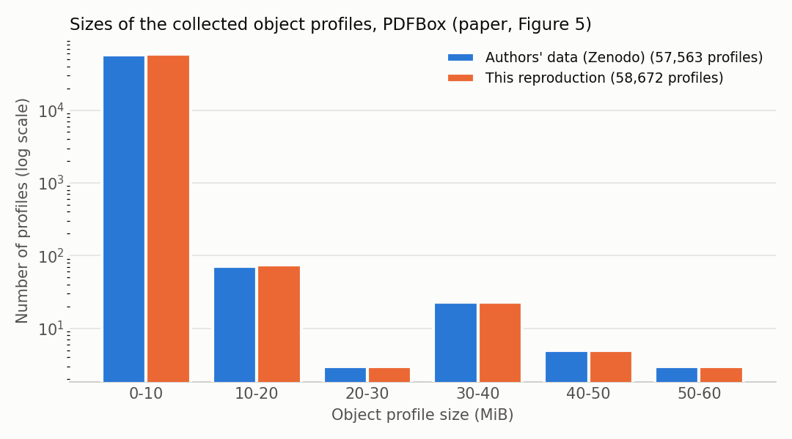

# Reproduction de l'étude de cas 2 (PDFBox) de « Production Monitoring to Improve Test Suites »

*Rapport de reproduction, rédigé au fil du travail. État : 22 octobre 2026 (fin du jour 7).*

Conventions :
- **[Publié]** : valeur ou affirmation de l'article ;
- **[Artefacts]** : données publiées par les auteurs (dépôt `pankti-experiments`, archive Zenodo) ;
- **[Mesuré]** : résultat obtenu dans cette reproduction ;
- **[Interprétation]** : analyse personnelle, distincte des faits.

Les chemins `docs/...`, `results/...` et `analysis/...` renvoient à ce dépôt. Chaque nombre cité est produit par un script du dépôt ou par une exécution GitHub Actions identifiée.

---

## 1. Introduction et objectifs

Le travail demandé consiste à reproduire les résultats de l'étude de cas 2 (section IV.C) de l'article suivant :

> D. Tiwari, L. Zhang, M. Monperrus, B. Baudry, *Production Monitoring to Improve Test Suites*, IEEE Transactions on Reliability, 2021 (arXiv 2012.01198v4).

Il faut ensuite documenter le code dans un dépôt GitHub et résumer l'expérience, les observations et les réflexions dans un rapport.

**Question de recherche de l'article.** Peut-on améliorer une suite de tests en observant l'application en production ? L'outil proposé, PANKTI :
1. instrumente des méthodes « cibles » ;
2. enregistre, pour chaque appel, l'objet receveur, les arguments et la valeur renvoyée (un *profil d'objet*) ;
3. transforme chaque profil distinct en *test unitaire différentiel* : désérialiser, appeler la méthode, comparer le résultat à la valeur observée.

Les cibles sont des méthodes *pseudo-testées* : elles sont exécutées par les tests existants, mais aucun test n'échoue si leur corps est remplacé par une valeur par défaut. Ce critère est mesuré par l'outil Descartes.

**Étude de cas 2.** PANKTI est appliqué à Apache PDFBox 2.0.21 avec une charge de travail : 10 commandes en ligne × 5 fichiers PDF du corpus GovDocs1.

Résultats à reproduire **[Publié]** :

| Grandeur | Valeur publiée |
|---|---|
| #TARGET (méthodes pseudo-testées ciblées) | 138 |
| #EFF_TARGET (cibles invoquées par la charge) | 46 |
| Invocations / profils collectés / profils uniques | 121 175 / 57 563 / 13 851 |
| Taille des profils | 5,5 Go ; de 158 octets à environ 55 Mo ; profondeur d'imbrication maximale 36 |
| Méthodes ayant atteint le seuil de 200 Mo | 19 |
| Tests générés / qui passent / qui échouent | 13 851 / 13 614 (98,3 %) / 237 |
| Cibles devenues « bien testées » | 28 sur 46 (60,9 %) |
| Exemple | `RenderingMode.isFill` : 30 944 appels, un seul profil distinct, un test intégré ensuite à PDFBox |

**Démarche.** La reproduction suit deux pistes :
- **(A)** confronter l'article aux artefacts publiés par les auteurs ;
- **(B)** ré-exécuter toute la chaîne dans un environnement contrôlé et documenté (GitHub Actions, Linux).

## 2. Méthodologie originale

La chaîne de l'étude de cas comporte cinq étapes ; les métriques sont définies à la section III.E de l'article.

1. **Cibles.** Descartes analyse la suite de tests de PDFBox par *mutation extrême* : le corps de chaque méthode est remplacé par `return null`, `true`/`false`, `0`/`1`, etc. Une méthode couverte dont aucun mutant n'est détecté est *pseudo-testée*. PANKTI ne retient que les méthodes publiques, non statiques, non abstraites, non vides, non dépréciées et qui renvoient une valeur. Cela donne #TARGET.
2. **Observation.** Les cibles sont instrumentées par un plugin Glowroot. PDFBox exécute la charge de travail ; chaque appel d'une cible est sérialisé en XML (XStream). Un seuil de 200 Mo par méthode limite la collecte. On en tire #EFF_TARGET, #INVOCATIONS, #COLLECTED et SIZE.
3. **Génération.** Un test est produit par profil distinct (#UNIQUE = #PANKTI_TESTS).
4. **Exécution.** Chaque test est exécuté (5 fois, contre le non-déterminisme), ce qui donne #PASSING et #FAILING.
5. **Évaluation.** Descartes est relancé avec les nouveaux tests. Une cible qui n'est plus pseudo-testée est « bien testée » (métrique 14 : « not pseudo-tested anymore »), c'est-à-dire *tested* ou *partially-tested* pour Descartes.

**[Artefacts]** Avec cette lecture, les derniers rapports Descartes des auteurs redonnent exactement les 46 statuts du tableau III (`results/day1/authors_report_vs_paper.csv`).

L'article ne précise pas : la version de PANKTI, celles de Descartes et de PIT, la configuration de Descartes, ni le script exact de la charge de travail. Tous ces éléments ont été retrouvés dans les artefacts des auteurs (section 5).

## 3. Méthodologie d'implémentation

**Principe.** Le dépôt ne réimplémente pas PANKTI : il pilote les outils originaux et mesure leurs sorties. Les étapes sont des flux GitHub Actions :

| Flux | Rôle |
|---|---|
| `env-check` | construction de PDFBox 2.0.21 et de sa suite de tests |
| `descartes-before` | Descartes, un module par tâche |
| `production-run` | plugin PANKTI, Glowroot, `pdfbox-app`, puis la charge de travail (modes `dry-run`, `smoke`, `full`) |
| `generate-tests` | génération des tests (pankti-generate) à partir de nos profils et de ceux des auteurs |
| `assess-tests` | intégration des tests dans PDFBox et exécution répétée (5 fois) |
| `descartes-after` | Descartes après ajout des tests générés qui réussissent (les nôtres, ceux des auteurs, aucun pour le contrôle) |

Des scripts Python dans `analysis/` calculent les métriques à partir des sorties brutes. Ils ont des tests unitaires (`tests/`).

**Procédure suivie :**
1. Construction de PDFBox et ajustements de construction (`scripts/pdfbox/patch-build.sh`).
2. Descartes « avant » sur les 6 modules, avec un seul fil d'exécution (`docs/descartes.md`).
3. Extraction des cibles avec les outils des auteurs (`scripts/pankti/extract-targets.sh`), puis liste figée `results/targets.csv`.
4. Plugin construit avec le générateur des auteurs (`instrument.py`), installé dans Glowroot. Vérification sans charge de travail.
5. Charge de travail : le script `run.sh` des auteurs, inchangé sauf les deux chemins propres à leur machine.
6. Métriques des profils (`analysis/profile_stats.py --fragments`) et comparaison au tableau III (`analysis/compare_table3.py`).
7. Génération des tests avec pankti-generate (`scripts/pankti/generate-tests.sh`), à partir de nos profils et, pour validation, de ceux des auteurs (`docs/generation.md`).
8. Intégration des tests dans PDFBox (`scripts/pankti/integrate-tests.sh`).
9. Exécution des tests générés 5 fois, chaque fois dans une nouvelle JVM (`scripts/pankti/run-generated-tests.sh`), et décompte par méthode (`analysis/test_outcomes.py`).
10. Descartes « après » sur fontbox et pdfbox, avec les seuls tests qui réussissent aux 5 exécutions (`scripts/pankti/keep_passing_tests.py`), puis statut final des cibles (`analysis/pankti_status.py`, `analysis/table3_status.py`). Une exécution de contrôle sans test généré sert de témoin.

**Validation des outils de mesure.** Avant d'être appliqués à nos données, les scripts de mesure ont été validés sur les données brutes des auteurs (5,9 Go de profils XML). **[Mesuré sur les artefacts]** Ils redonnent exactement :
- les colonnes #INVOCATIONS, #COLLECTED et #UNIQUE du tableau III pour les 46 méthodes (121 175 / 57 563 / 13 851) ;
- les 19 méthodes plafonnées ;
- la taille minimale (158 octets) et la taille totale (5,49 Gio).

(`results/day4/authors_profile_metrics.txt`)

## 4. Environnement expérimental

Mesures (détails dans `docs/environment.md`) :
- exécuteur GitHub `ubuntu-22.04`, 4 vCPU AMD EPYC 7763, 15 Gio ;
- AdoptOpenJDK 11.0.8+10, celui du journal d'exécution des auteurs ;
- Maven 3.6.3, polices Liberation ;
- PDFBox 2.0.21 (`fa8029d8`), PIT 1.4.10 + Descartes 1.2.6 (21 opérateurs), PANKTI `0fddf27` (dernier commit avant l'exécution des auteurs du 3 novembre 2020), Glowroot 0.13.6 ;
- générateur pankti-generate `7afc584` (version des tests publiés, section 5, point 7) ;
- données Zenodo, version 1.

Configuration des étapes :
- Descartes : un seul fil d'exécution, opérateurs et délais par défaut, classes cibles par module ;
- charge de travail : `run.sh` des auteurs, cache de polices vide, 50 lancements de JVM ;
- génération : tas de 12 Go ;
- exécution des tests : réglages surefire de PDFBox (`-Xmx768m` pour le module pdfbox), 5 exécutions séparées ;
- Descartes « après » : même configuration que « avant », mutation limitée aux 22 classes qui déclarent les cibles effectives, avec tous les tests du module.

Le portable Windows sert seulement au développement : le système d'exploitation influence les résultats (section 8).

## 5. Difficultés rencontrées

1. **Construction de PDFBox 2.0.21 six ans après.** La construction ne fonctionne plus telle quelle :
   - trois téléchargements de ressources de test sont morts (polices IPA, suite Isartor, un PDF de politique de certification) ;
   - un test dépend de l'ordre d'exécution ;
   - le certificat de test a expiré le 5 juin 2026.

   Il a fallu cinq exécutions d'intégration continue pour obtenir une construction propre. Les fichiers de remplacement, pris dans l'Internet Archive, ont la même empreinte sha512 que les originaux.
2. **Parallélisme de l'analyse de mutation.** Avec 4 fils PIT, choix naturel sur une machine à 4 cœurs, 25 des 40 cibles du module pdfbox devenaient « testées », dont `isFill`, ce qui contredisait l'article.
   - **Diagnostic** à partir des statuts de chaque mutant : 215 détections supplémentaires sont des dépassements de délai, 65 des échecs de tests qui écrivent dans des fichiers communs (`target/test-output`) ou téléchargent des PDF pendant le test.
   - **Confirmation** par une ré-exécution à un fil, qui redonne les résultats des auteurs.
   - **Conséquence si cela était passé inaperçu :** 91 cibles au lieu de 138, dont seulement 21 des 46 cibles effectives.
3. **Surcharges de méthodes.** Une première comparaison par nom de méthode fusionnait des surcharges (`toUnicode`, `getPath`). Corrigé en identifiant les méthodes par leur descripteur de paramètres, comme le fait PANKTI.
4. **Dérive des dépendances de PANKTI.**
   - pankti-extract (2020) se construit encore, mais le dépôt de snapshots qu'il déclare n'existe plus.
   - Ses intervalles de versions tirent aujourd'hui des bibliothèques Eclipse compilées pour Java 17 dans un outil exécuté en Java 11. Cela ne fonctionne que parce que ces classes ne sont jamais chargées.
5. **Fins de ligne et environnement Windows.**
   - Un jar construit depuis une copie Windows du code diffère de celui des auteurs sur 118 ressources texte.
   - Une empreinte calculée sur une copie Windows ne correspondait pas au fichier versionné (corrigé avant publication).
   - Un script fonctionnait avec un chemin absolu mais pas avec le chemin relatif utilisé en intégration continue ; une exécution a échoué, puis tout a été rejoué localement à l'identique avant de relancer.
6. **Définition de la « profondeur d'imbrication ».** L'article annonce une profondeur maximale de 36 sans la définir. Sur les données brutes des auteurs, la profondeur des éléments XML atteint 73 (`COSParser.getEncryption`). Aucune autre définition essayée ne donne 36 (sans les éléments `entry` : 72 ; éléments typés seulement : 51). L'autre chiffre de l'article, « `toUnicode` imbriqué sur 13 niveaux », correspond bien à la profondeur XML moins un (14 − 1). Question laissée ouverte (section 7).
7. **Version du générateur et retouches manuelles.** Les tests publiés par les auteurs n'ont pas été produits par la version de PANKTI utilisée pour la charge de travail (`0fddf27`). Ils contiennent des méthodes `deserializeObject()` que le générateur n'écrit qu'à partir du commit `7afc584` (12 novembre 2020), une méthode `setUpXStream()` dont l'appel est commenté dans le code du générateur, et des imports ajoutés à la main. L'hypothèse a été vérifiée en régénérant tous les tests à partir des profils des auteurs (section 7.6).
8. **Niveau de compilation des tests.** Les tests générés utilisent des convertisseurs qui dépendent de `java.lang.ref.Cleaner` (Java 9). Sous JDK 11, un profil de PDFBox impose `<release>6</release>` à toute compilation, ce qui annulait le réglage `testSource`/`testTarget` ; la compilation échouait. Seule la compilation des tests reçoit désormais `<release>9</release>`.
9. **Mémoire.** pankti-generate charge chaque fichier de profils (jusqu'à 210 Mo) en DOM ; la génération demande environ 12 Go et s'exécute sur l'exécuteur d'intégration continue, le portable n'ayant pas assez de mémoire libre.
10. **Découpage des classes de tests.** La première exécution a donné 301 échecs inattendus dans `HorizontalMetricsTable`. Cause : mon script de découpage des grandes classes supprimait la méthode `setUpXStream()`, que le générateur place entre les tests de deux méthodes cibles ; sans elle, le convertisseur nécessaire à la désérialisation d'un descripteur de fichier n'était pas enregistré. Corrigé, avec un test unitaire ; le résultat erroné est conservé comme trace (`results/day6/run-39641425498-split-bug/`).
11. **Tests publiés non compilables.** 18 des 22 classes publiées par les auteurs utilisent `@Before` sans l'importer ; l'import manquant a été ajouté à ces classes seulement (hypothèse A20).
12. **Sélection des tests par PIT.** Pour limiter Descartes « après » aux classes des cibles, j'ai restreint `targetClasses`. Un essai local a montré que toutes les méthodes devenaient « non couvertes » : pitest-maven restreint aussi, par défaut, les tests à ce même motif, et n'exécutait donc aucun test. Les tests sont désormais toujours désignés explicitement (`targetTests`).
13. **Un test instable sur une cible.** L'exécution de contrôle sans test généré a rendu `XrefTrailerResolver.getXrefType` « testée ». Le mutant `null` est tué par `TestOptionalContentGroups.testOCGConsumption` dans une exécution et pas dans l'autre. Ce test relit un fichier PDF laissé dans `target/test-output` et ne le régénère que s'il est absent ; le résultat dépend donc des fichiers écrits auparavant (section 7.8).

## 6. Hypothèses simplificatrices et adaptations méthodologiques

La liste complète, au format exigé (exigence d'origine, problème, simplification, justification, impact attendu, validation, restitution), est dans `docs/assumptions.md` (A1 à A22). Les plus importantes :

| # | Adaptation | Pourquoi | Impact et validation |
|---|---|---|---|
| A1 | Ajustements de construction de PDFBox, sans changer le code de la bibliothèque ni des tests | ressources mortes, test dépendant de l'ordre | aucun sur le code étudié ; 1 678 tests exécutés |
| A2 | Exclusion des deux classes de tests au certificat expiré pour Descartes | PIT exige une suite verte | le module `examples` perd sa couverture ; aucune cible n'y est |
| A3 | PIT 1.4.10 + Descartes 1.2.6, 21 opérateurs, **un seul fil** | versions non documentées ; parallélisme faussant les résultats | classification identique à celle des auteurs pour 4 modules, 99,6 % pour pdfbox |
| A5 | Toutes les mesures sous Linux | les polices et le système changent les résultats | vérifié sur Descartes (4 méthodes changent sous Windows) |
| A8 | Liste de cibles figée à partir des rapports Descartes des auteurs | calendrier | notre propre exécution donne aussi 138 cibles, dont 137 communes |
| A12 | `pdfbox-app` reconstruit depuis le tag 2.0.21 | le jar des auteurs n'est pas celui de Maven Central | contenu identique (5 644 classes sur 5 644) |
| A14 | `run.sh` des auteurs avec seulement deux chemins remplacés | chemins propres à leur machine | différence de 2 lignes, conservée avec les résultats |
| A15 | #UNIQUE calculé sur le texte exact des fragments XML | reproduire la règle de pankti-generate sans le lancer | validé : 46 valeurs sur 46 identiques au tableau III |
| A11 | #PASSING ne compte que les tests réellement exécutés | les artefacts montrent 11 613 tests comptés comme réussis sans avoir été exécutés | tous nos tests ont été exécutés ; les 11 613 tests concernés réussissent |
| A19 | 5 exécutions dans des JVM séparées, réglages de test de PDFBox ; réussi = réussit aux 5 exécutions | l'article ne précise pas le protocole | 0 test instable |
| A20 | Import `org.junit.Before` ajouté aux classes publiées qui l'utilisent sans l'importer | les tests publiés ne compilent pas tels quels | réparation journalisée classe par classe |
| A17 | Générateur pankti-generate `7afc584` avec `setUpXStream()` activé | version des tests publiés par les auteurs ; même analyseur de profils que `0fddf27` | validé : 13 851 tests sur 13 851 identiques aux tests publiés |
| A18 | Seule la compilation des tests passe en Java 9 ; convertisseurs copiés dans chaque paquetage ; classes de plus de 500 tests découpées | ne pas modifier le bytecode de la bibliothèque mutée ; permettre d'exécuter les 11 730 tests de `getFlags` | vérifié localement : bibliothèque en Java 6 (version 50), tests en Java 9 (53), 20 tests sur 20 passent |
| A21 | Descartes « après » limité aux 22 classes des cibles effectives, avec tous les tests du module | durée (68 min pour pdfbox entier, sans les tests générés) ; l'article ne dit pas ce que les auteurs ont analysé | contrôle sans test généré : 460 méthodes sur 465 classées comme dans l'exécution complète ; les 5 autres viennent d'un test instable |
| A22 | Seuls les tests qui réussissent aux 5 exécutions sont ajoutés | PIT exige une suite verte ; section II.F de l'article | 14 314 de nos tests, 13 614 de ceux des auteurs, comme au jour 6 |

## 7. Résultats et comparaison

### 7.1 Cohérence de l'article et de ses artefacts (piste A)

- **[Artefacts]** Les données brutes redonnent exactement les nombres de la section IV.C :
  - 121 175 invocations, 57 563 profils, 13 851 profils uniques ;
  - 158 octets au minimum ;
  - un maximum de 54,7 Mio et un total de 5,49 Gio : l'article utilise des unités binaires ;
  - les 19 méthodes plafonnées ont toutes un fichier XML d'au moins 200 Mio.
- **[Artefacts]** Aucun fichier des auteurs ne présente de décalage entre le nombre de receveurs, d'arguments et de valeurs renvoyées. Le risque d'appariement identifié dans le code de PANKTI (un appel qui lève une exception n'écrit pas de valeur renvoyée) ne s'est pas réalisé dans leur exécution.
- **[Artefacts]** Sur les 11 730 tests générés pour `GlyfSimpleDescript.getFlags`, seuls 117 ont été exécutés. Les 13 614 tests « qui passent » de l'article en comptent 11 613 jamais exécutés. Tests réellement exécutés : 2 238, dont 2 001 passent (89,4 %, contre 98,3 % annoncés).
- **[Artefacts]** Le jar `pdfbox-app` des auteurs est PDFBox 2.0.21 sans modification, construit le 21 septembre 2020 avec le même JDK.
- **[Artefacts]** Dans la charge de travail des auteurs, seules 39 commandes sur 50 réussissent. Les 9 erreurs concernent toutes le fichier `000809.pdf`, déjà chiffré, ce qui fait échouer `Encrypt` et toutes les étapes suivantes. Les 2 messages d'usage viennent de `PDFMerger` (`results/day4/`, `analysis/workload_log.py`).

### 7.2 Méthodes pseudo-testées et cibles (piste B)

| | Article / auteurs | Reproduction |
|---|---|---|
| #TARGET | 138 | **138** (137 en commun avec la liste issue des rapports des auteurs) |
| Cibles effectives présentes dans la liste | 46 | 46 sur 46, toutes pseudo-testées avant ajout de tests |
| Classification Descartes identique aux auteurs | — | 6 276 méthodes sur 6 373 (fontbox, xmpbox, preflight, tools : 100 % ; pdfbox : 99,6 %) |

### 7.3 Instrumentation et charge de travail (piste B)

- **[Mesuré]** Le plugin compte un aspect par cible (138 sur 138). Glowroot 0.13.6 démarre avec lui sans avertissement.
- **[Mesuré]** Test de fumée (`PDFToImage` sur un PDF, deux fois) :
  - `isFill` est enregistrée, avec des profils de 158 octets et un seul profil distinct, comme dans l'article ;
  - le compteur d'invocations s'additionne d'un lancement de JVM à l'autre (4 349 puis 8 698) ;
  - même cette petite exécution produit 3,4 Go de profils, et 11 méthodes atteignent déjà le seuil de 200 Mo (`results/day4/smoke/`).
- **[Mesuré]** Charge de travail complète (exécution 39444526027, 50 lancements de JVM, 11 min 27 s) : les 50 commandes ont le même résultat que dans le journal des auteurs (39 réussites, 9 erreurs sur `000809.pdf`, 2 messages d'usage de `PDFMerger`).

| Colonnes 1 à 3 du tableau III | Article | Reproduction |
|---|---|---|
| #EFF_TARGET | 46 | 47 (les 46, plus `TrueTypeFont.getOS2Windows`) |
| #INVOCATIONS | 121 175 | 122 384 (+1,0 %) |
| #COLLECTED | 57 563 | 58 672 (+1,9 %) |
| #UNIQUE | 13 851 | 14 679 (+6,0 %) |
| Ratios collectés / invocations, uniques / collectés | 47,5 % ; 24 % | 47,9 % ; 25,0 % |
| Méthodes ayant atteint le seuil de 200 Mo | 19 | 19 |
| Plus petit / plus grand profil ; total | 158 o / ≈ 55 Mo ; 5,5 Go | 158 o / 54,7 Mio ; 5,30 Gio |
| `RenderingMode.isFill` | 30 944 / 30 944 / 1 profil de 158 o | **identique** |
| Lignes identiques au tableau III (INV / COLL / UNIQ) | — | 41 / 40 / 38 sur 46 |

  (`results/day4/table3_comparison.*`, `results/day4/full/`)
- **[Mesuré]** Les lignes qui diffèrent sont des méthodes liées aux polices : `NamingTable.getName` (650 → 1 457 invocations, 273 → 976 profils uniques), `PDFontDescriptor.getFlags`, `isSerif`, `isItalic`, `isFixedPitch`, `FontCache.getFont`. S'y ajoutent deux méthodes dont les profils collectés dépendent de ce qui a été stocké avant le seuil (`DefaultResourceCache.getColorSpace`, `COSParser.getEncryption`), et la cible supplémentaire `getOS2Windows`, elle aussi liée aux polices.
- **[Interprétation]** Cause probable : les polices installées. PDFBox remplace les polices non incorporées par des polices du système et les met en cache ; l'exécuteur en possède 57, et le jeu de polices de la machine des auteurs est inconnu. Ce n'est pas vérifié : il faudrait une exécution avec un autre jeu de polices.

### 7.4 Profondeur d'imbrication

**[Mesuré]** La profondeur maximale des éléments XML vaut 73 dans les données des auteurs comme dans les nôtres (36 annoncé dans l'article). Faute de définition, la même mesure est appliquée aux deux jeux de données ; elle concorde entre eux, mais pas avec la valeur publiée.

### 7.5 Figure 5 : taille des profils

| Tranche (Mio) | 0-10 | 10-20 | 20-30 | 30-40 | 40-50 | 50-60 |
|---|---|---|---|---|---|---|
| Données des auteurs (= figure 5 de l'article) | 57 458 | 71 | 3 | 23 | 5 | 3 |
| Reproduction | 58 563 | 75 | 3 | 23 | 5 | 3 |

**[Mesuré]** Même forme que la figure de l'article ; les tranches au-delà de 20 Mio, qui correspondent aux méthodes plafonnées, sont identiques. (`results/day5/fig5.csv`)

### 7.6 Génération des tests

- **[Mesuré sur les artefacts]** À partir des profils des auteurs, pankti-generate `7afc584` (avec `setUpXStream()` activé) produit 13 851 tests, **tous identiques, méthode par méthode, aux 13 851 tests publiés** ; #PANKTI_TESTS = #UNIQUE pour les 46 méthodes. L'étape de génération est donc reproduite exactement. (`results/day5/authors_generation/`)
- **[Mesuré]** À partir de nos profils : 14 679 tests pour 47 méthodes, égal à #UNIQUE pour chaque méthode (article : 13 851). Les écarts avec l'article sont ceux de #UNIQUE, concentrés sur les méthodes liées aux polices. (`results/day5/table3_partial.csv`)
- **[Mesuré]** Intégration vérifiée localement sur un échantillon : les tests compilent et passent ; l'exécution complète (5 fois) est l'objet du jour 6.

### 7.7 Exécution des tests générés

Chaque test est exécuté 5 fois, chaque fois dans une nouvelle JVM, avec les réglages de test de PDFBox. Un test est compté comme réussi s'il réussit aux 5 exécutions (hypothèse A19).

| | Tests | Réussis (5/5) | Échoués (5/5) | Instables | Taux de réussite |
|---|---|---|---|---|---|
| **[Publié]** Tableau III | 13 851 | 13 614 | 237 | | 98,29 % |
| **[Mesuré]** Tests publiés par les auteurs, exécutés ici | 13 851 | 13 614 | 237 | 0 | 98,29 % |
| **[Mesuré]** Tests de la reproduction | 14 679 | 14 314 | 365 | 0 | 97,51 % |

- **[Mesuré]** Les tests des auteurs, exécutés dans notre environnement, redonnent exactement les colonnes #PASSING et #FAILING du tableau III, **pour les 46 méthodes**. Les 11 613 tests de `getFlags` que les auteurs comptaient comme réussis sans les avoir exécutés réussissent effectivement.
- **[Mesuré]** Nos tests donnent les valeurs de l'article pour 38 des 46 méthodes. Dans les 8 autres, le nombre de tests diffère (profils uniques différents, surtout pour les méthodes liées aux polices). Les 128 échecs supplémentaires sont exactement les tests en plus de 4 méthodes : `TrueTypeFont.getOS2Windows` (absente du tableau III, 114 tests, tous en échec), `FontCache.getFont` (+8), `DefaultResourceCache.getColorSpace` (+4), `COSParser.getEncryption` (+2).
- **[Mesuré]** Aucun test instable sur 5 exécutions.
- **[Interprétation]** L'exécution des tests est reproduite ; les écarts viennent des profils collectés, pas de l'exécution. Les échecs sont des `AssertionError` (objet désérialisé différent de l'objet observé : `equals()` non redéfini, état transitoire, caches absents ; section V.A de l'article), et, pour `getOS2Windows`, des erreurs d'entrée-sortie : ses profils contiennent un fichier de police ouvert, qu'un test ne peut pas restaurer.

(`results/day6/table3_execution.csv`, `docs/execution.md`)

### 7.8 Statut final des cibles

Descartes est relancé (même configuration, 1 fil) avec les tests générés qui réussissent aux 5 exécutions. Trois sources de tests, chacune sur fontbox et pdfbox (exécution 39747040848) : aucun test généré (contrôle), nos 14 314 tests, les 13 614 tests publiés par les auteurs.

| Cibles « bien testées » (testées + partiellement testées) | Nombre | Statut identique au tableau III |
|---|---|---|
| **[Publié]** Tableau III | 28 / 46 (17 + 11) | |
| **[Mesuré]** Tests des auteurs, exécutés ici | 28 / 46 (17 + 11) | 46 / 46 |
| **[Mesuré]** Tests de la reproduction | **28 / 46 (17 + 11)** | **46 / 46** |
| **[Mesuré]** Contrôle, sans test généré | 1 / 46 | 19 / 46 |

- **[Mesuré]** Le statut final est reproduit exactement, avec nos tests comme avec ceux des auteurs. Les deux jeux de tests donnent la même classification pour les 465 méthodes analysées, bien que nos tests diffèrent pour 8 méthodes : les tests en plus ne changent aucun statut. La 47e cible, `getOS2Windows`, n'a aucun test qui réussit et reste pseudo-testée. (`results/day7/table3_status.csv`)
- **[Mesuré]** Exemples de l'article :
  - `RenderingMode.isFill` est **partiellement testée** : la seule valeur observée est `true`, donc le test généré tue le mutant `false` mais pas le mutant `true` ;
  - `NamingTable.getName` est **testée** : les mutants `null`, `"A"` et `""` sont tous tués (section II.C de l'article).
- **[Mesuré]** Les rapports « après » publiés par les auteurs portent sur les modules entiers ; sur les 465 méthodes analysées ici, ils concordent pour 460, dont les 46 cibles. Les 5 autres ne sont pas des cibles.
- **[Mesuré]** Validation de la restriction aux 22 classes : le contrôle donne la classification de l'exécution complète « avant » pour 460 des 465 méthodes. Les 5 écarts ne viennent pas de la restriction (les tests sont les mêmes) mais d'un test instable, `testOCGConsumption`, et d'un dépassement de délai.
- **[Mesuré]** L'un de ces écarts touche une cible : le mutant `null` de `XrefTrailerResolver.getXrefType` survit aux 183 tests qui la couvrent dans l'exécution complète « avant », mais est tué par le 53e d'entre eux dans le contrôle.
- **[Interprétation]** Le statut « pseudo-testée avant » de `getXrefType` n'est donc pas stable. En ne comptant que les cibles pseudo-testées dans les deux exécutions sans test généré, **27 des 46 cibles** sont améliorées de façon robuste par les tests de PANKTI ; le nombre publié (28) reste exact pour la configuration de l'article.

(`results/day7/`, `docs/descartes.md`, `docs/discrepancies.md` §23-24)

## 8. Observations et réflexions

### 8.1 Observations

- **[Mesuré]** Le seuil de 200 Mo est atteint très vite : deux exécutions d'une seule commande suffisent pour 11 méthodes. Il borne fortement #COLLECTED pour les méthodes appelées sur de gros objets, et les profils les plus volumineux (au-delà de 20 Mio) sont exactement les mêmes dans les deux exécutions.
- **[Mesuré]** La charge de travail elle-même est parfaitement reproductible (mêmes commandes, mêmes erreurs). Ce qui varie, ce sont les méthodes liées aux polices : `NamingTable.getName` passe de 273 à 976 profils uniques.
- **[Interprétation]** Une « production » n'est donc pas seulement une suite d'entrées : l'état de la machine (polices installées) en fait partie, et les tests générés en dépendent. Cause probable, non vérifiée faute d'une exécution avec un autre jeu de polices.
- **[Mesuré]** La charge de travail des auteurs est plus petite qu'annoncé : 11 des 50 appels échouent, dont tous ceux sur `000809.pdf`, déjà chiffré. Ce détail ne figure pas dans l'article. Il ne change pas les métriques publiées, qui proviennent de cette même exécution, mais réduit la diversité réelle des entrées observées.
- **[Mesuré]** Une analyse de mutation n'est pas plus déterministe que la suite de tests qu'elle exécute : avec 4 fils, des tests qui partagent des fichiers ou téléchargent des données font compter comme « détectés » des mutants qui ne le sont pas, au point de faire passer les cibles de 138 à 91.
- **[Mesuré sur les artefacts]** Les artefacts publiés mélangent deux versions de l'outil et des retouches manuelles : instrumentation en `0fddf27`, génération en `7afc584`, imports et classes de conversion ajoutés à la main. Rien de cela n'est dit dans l'article ; les nombres publiés restent néanmoins exactement reproductibles à partir des artefacts.
- **[Mesuré sur les artefacts]** Compter des tests non exécutés comme réussis surestime le taux de réussite (98,3 % contre 89,4 % sur les tests réellement exécutés).
- **[Mesuré]** Le résultat final de l'article (28 / 46) est robuste à la variation des profils : nos 828 tests supplémentaires (dont 114 pour la cible en plus, `getOS2Windows`) ne changent aucun statut. Un seul profil distinct par méthode suffit souvent : `isFill` est améliorée par un unique test.
- **[Mesuré]** Le critère « bien testée » dépend de la stabilité de la suite de tests existante. Un test qui relit un fichier laissé par une exécution précédente peut faire passer une cible de « pseudo-testée » à « testée » sans aucun nouveau test (`getXrefType`).

### 8.2 Réflexions et leçons apprises

- **[Interprétation]** La reproductibilité dépend des artefacts bien plus que du texte. L'article ne donne ni versions, ni configuration de Descartes, ni script de charge. Sans le dépôt d'expériences et l'archive Zenodo, ces éléments seraient des suppositions ; avec eux, plusieurs résultats sont reproduits à l'identique six ans plus tard.
- **Ce qui a fonctionné.** Valider chaque outil de mesure sur les données des auteurs avant de l'appliquer aux nôtres (comptage des profils uniques, comptage des tests, comparaison des tests). Cela a révélé un défaut de mon analyseur XML (les éléments vides) avant qu'il ne fausse un résultat, et chaque comparaison sert ensuite de test de non-régression.
- **Ce qui a fonctionné.** Traiter chaque résultat surprenant comme un indice : `isFill` « testée » a révélé l'effet du parallélisme ; des tests publiés différents des nôtres ont révélé la version du générateur.
- **Ce qui a moins bien fonctionné.** Plusieurs échecs d'intégration continue venaient de différences entre l'environnement local (Windows : fins de ligne, conversion des chemins) et l'exécuteur Linux. Rejouer localement l'appel exact de l'intégration continue avant de pousser a évité de les répéter.
- **À reconsidérer.** Choisir dès le départ le même système d'exploitation pour le développement et les mesures, et figer toutes les dépendances (y compris celles des outils des auteurs).
- **Sur la méthode de l'article.** L'oracle dérivé de la production dépend de choix d'outillage non décrits (nombre de fils de PIT, version du générateur, convertisseurs XStream) et de l'environnement (polices). Ces choix influencent fortement les nombres publiés ; un article de ce type gagnerait à les documenter explicitement.

## 9. Limites et menaces à la validité

- La machine des auteurs (polices installées, cache de polices) est inconnue. Les nombres d'invocations des méthodes liées aux polices diffèrent ; la cause n'est pas vérifiée.
- Le module `examples` n'est plus couvert après l'exclusion des tests au certificat expiré. C'est sans effet sur les cibles.
- La définition de la profondeur d'imbrication n'est pas documentée ; la valeur 36 n'est pas reproduite.
- La génération utilise une version du générateur postérieure à l'instrumentation, comme les auteurs ; le nombre de tests n'en dépend pas (même analyseur), mais leur forme oui.
- Contraintes de calendrier : pas d'analyses de sensibilité (charge de travail corrigée pour `000809`, exécution sous Windows, autre jeu de polices), ni des chiffres de couverture du tableau II.
- Descartes « après » n'analyse que les 22 classes des cibles, et une seule exécution de contrôle a été faite : d'autres tests instables peuvent exister sans s'être manifestés.

## 10. Conclusion et travaux futurs

*(à rédiger en fin de projet)* À ce stade :
- les cibles (138) sont reproduites exactement ; la classification Descartes est quasi identique à celle des auteurs ;
- l'outillage de mesure et l'étape de génération sont validés sur les données des auteurs (13 851 tests sur 13 851 identiques) ;
- la charge de travail redonne les colonnes 1 à 4 du tableau III à quelques pour cent près (mêmes 46 cibles, mêmes 19 méthodes plafonnées, `isFill` à l'identique, figure 5 de même forme) ; les écarts se concentrent sur les méthodes liées aux polices ;
- l'exécution des tests publiés redonne exactement #PASSING et #FAILING ; nos tests réussissent à 97,5 % ;
- le statut final est reproduit exactement : 28 cibles sur 46 deviennent bien testées, avec nos tests comme avec ceux des auteurs, et `isFill` est partiellement testée comme dans l'article. Une de ces 28 cibles dépend d'un test instable de PDFBox.

Restent l'analyse des échecs (catégories de la section V.A) et des cibles qui restent pseudo-testées malgré des tests qui réussissent (section V.B).

**Pistes :**
- rendre les tests de PDFBox sûrs en parallèle (répertoires temporaires distincts) et revérifier Descartes avec plusieurs fils ;
- figer les dépendances de pankti-extract ;
- mesurer l'effet des polices par une exécution avec un autre jeu de polices ;
- comparer avec la version de PANKTI corrigée pour l'appariement des profils (`326a753`).

## 11. Annexe : reproductibilité

**Versions.**

| Composant | Version |
|---|---|
| Exécuteur | GitHub Actions `ubuntu-22.04` (4 vCPU, 15 Gio), image consignée dans chaque `env-report.txt` |
| JDK / Maven | AdoptOpenJDK 11.0.8+10 / 3.6.3 (empreintes vérifiées) |
| PDFBox | 2.0.21, commit `fa8029d8` |
| PIT / Descartes | pitest-maven 1.4.10 / Descartes 1.2.6, 21 opérateurs, 1 fil |
| PANKTI | `0fddf27` (extraction, instrumentation), `7afc584` + une ligne (génération) |
| Glowroot | 0.13.6 (empreinte sha256 consignée) |
| XStream (tests) | 1.4.12 |
| Données des auteurs | Zenodo 4298605 (md5 `9c902f3e…`), `pankti-experiments` `7bc7791` et `1d8f9aa` |
| Analyse | Python 3.11 ; pandas 1.5.3 pour le script des auteurs |

**Exécutions GitHub Actions utilisées.**

| Étape | Flux | Exécution |
|---|---|---|
| Construction de référence | `env-check` | 38548431201 |
| Descartes « avant » | `descartes-before` | 39409510406 (6 modules), 39415980930 (pdfbox, 1 fil) |
| Instrumentation (vérification) | `production-run` (`dry-run`) | 39431056888 |
| Charge de travail | `production-run` (`smoke`, `full`) | 39442198598, 39444526027 |
| Génération | `generate-tests` | 39581267651 (auteurs), 39588027907 (reproduction) |
| Exécution des tests | `assess-tests` | 39644913295 (39641425498 : exécution erronée, conservée comme trace) |
| Descartes « après » | `descartes-after` | 39747040848 |

**Commandes.** Le README du dépôt donne les commandes pour reconstruire l'environnement local (`setup/`), lancer chaque flux (`gh workflow run …`) et refaire chaque analyse à partir des résultats enregistrés dans `results/`. Tests unitaires des scripts d'analyse : `python -m unittest discover -s tests`.

**Traçabilité.** Chaque nombre de ce rapport provient d'un fichier de `results/` (produit par un script de `analysis/` ou par un flux) ; le journal des expériences (`docs/experiments.md`) relie chaque résultat à son exécution.
